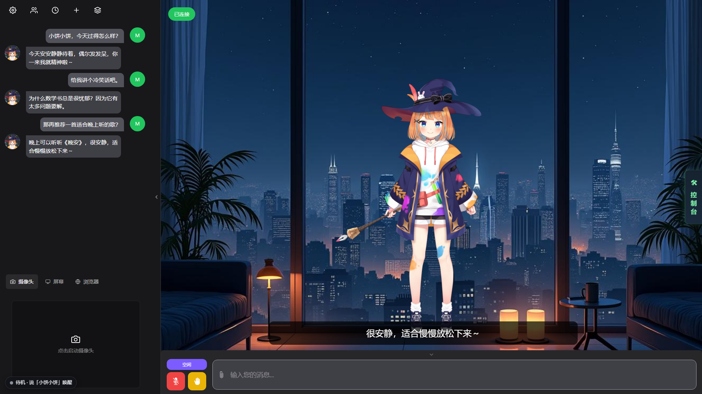
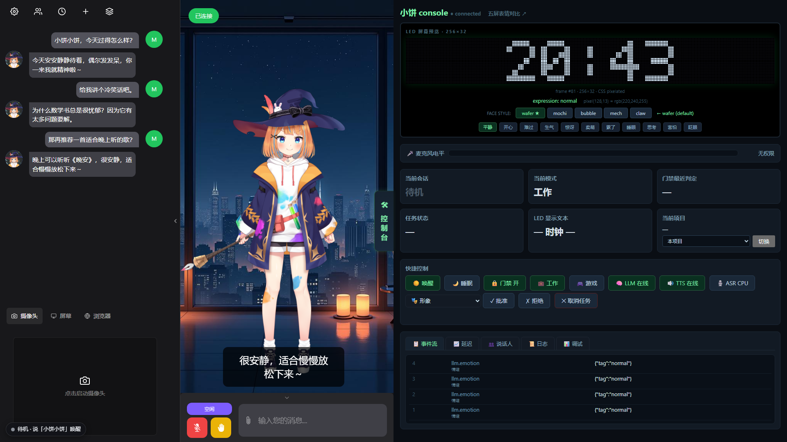
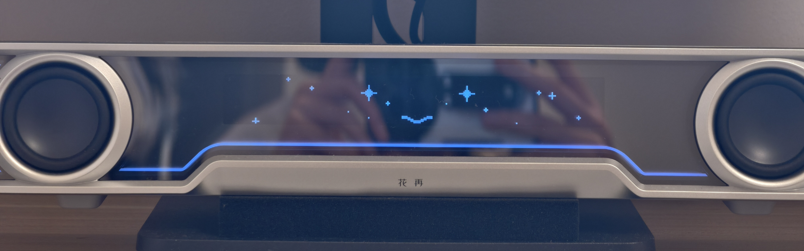

# wafer-pixel

> 把漫步者 Halo PixelBar 音箱变成有脸、有灯、只听家人话的语音 AI 管家。
> 默认全本地运行（ASR / LLM / TTS）；可选接入云端 LLM 与在线 TTS。Windows 11 + RTX 4070S 实测。

[](pyproject.toml)
[](LICENSE)
[](pyproject.toml)

## 这是什么

wafer-pixel 是一个“物理桌面 AI”实验项目：

- **声纹门禁**：本地 CAM++ 先判断说话人；陌生人/待机杂音不进入 ASR、不发云端、不产生回复。
- **本地语音闭环**：浏览器 VAD → 本地声纹门禁 → 本地 ASR → 本地 9B 或云端 LLM → 本地/在线 TTS → 音箱。
- **语音唤醒**：默认用 ASR 文本匹配「小饼小饼 / 小饼干活」；KWS 保留为实验开关。
- **LED 表情**：PixelBar 类别槽位 + 氛围灯状态指示；表情由确定性渲染管线驱动，LLM 只输出情绪标签。
- **编码派活**：说「小饼干活，帮我修一下登录报错」→ 转交 opencode 执行 → 进度/权限/结果回到语音和 LED。
- **隐私优先**：本地门禁和本地 ASR 是默认路径；在线模式只发送已放行的文本，不发送原始音频。

## 控制台一览

**OLV 全屏 / 控制台收起**：小饼的 Live2D 形象与对话区。



**展开控制台**：左侧保留对话，右侧同步 LED 时钟、会话状态、任务/权限、LLM/TTS/ASR 与 Live2D 形象切换。



## 实机效果



PixelBar 256×32 LED 上的庆祝表情（实拍）。

## 当前进度

| 能力 | 状态 | 说明 |
|---|---|---|
| 本地语音闭环 | 已完成 | VAD → CAM++ 门禁 → qwen3-asr → LLM → TTS；本地默认 |
| ASR 文本唤醒 | 已完成，默认 | 待机先经过本地门禁，再匹配「小饼小饼 / 小饼干活」 |
| KWS 唤醒 | 实验性 | 小模型对部分真实声线命中率不足；不作为默认 |
| LED 槽位表情 | 已完成 | slot 2-7 类别切换；控制台 LED 镜像时钟/表情 |
| 权限确认闭环 | 代码/单测完成 | 语音批准/拒绝、TASK_APPROVE、LED/表情同步；真机仍待完整复验 |
| opencode 派活 | 已完成 | 单任务、唯一 task_id、进度/结果播报、忙时拒绝 |
| 在线 LLM | 已接入并实测 | MaaS `deepseek-v4.1-flash`；默认在线，可切本地 |
| 在线 TTS | 已接入并实测 | Qwen3-TTS `Serena`；默认整段，realtime 为实验开关 |
| ASR CPU/GPU | 已完成 | 控制台切换；0.6B 实测 CPU/GPU 速度 |
| 多轮闲聊记忆 | v0.2 已完成 | L1 会话窗口 + L2 摘要/重启恢复 + L3 工作日志 |
| 统一控制台 | v0.2 已完成 | 舞台切换、延迟/首帧统计、说话人、日志、项目、形象切换 |
| Live2D 形象 | 已完成 | Hiyori / Mao / DeepSeek-chan / 鲸鱼女仆；控制台在线切换 |
| 在线 ASR | 未启用 | 保留扩展；必须先过本地 VAD + 门禁，默认不把音频发云端 |
| 自动化验证 | CI 绿 + 公开快照 | 公开仓 780 passed / 6 skipped（2026-11-08）；smoke 需本地模型（见 `INSTALL.md`） |

## 快速开始（零硬件模拟模式）

```bash
git clone https://gitee.com/Serius_117/wafer_pixelbar_public.git
cd wafer_pixelbar_public
pip install -e .[dev]

# 全量测试；不需要麦克风、音箱或模型
pytest -q

# 最小控制台：hub + render
python -m core.bus --port 8765 &
python -m render --port 8765 --console 8790 &
# 打开 http://localhost:8790
```

## 快速开始（真机模式）

前置：Windows 11、Python 3.11+、NVIDIA 显卡（本地 9B/ASR/TTS 参考 4070S）、PixelBar 音箱、麦克风权限。

```powershell
# 1) 安装
.\.venv\Scripts\python.exe -m pip install -e ".[dev]"

# 2) 检查本机配置
#    config/inference.yaml：本地模型与推理路径
#    config/providers.local.yaml：可选云端端点（不提交）
#    .env：可选云端 API key（不提交）

# 3) 一键启动（推理三件套 + hub/bridge/render/OLV）
.\.venv\Scripts\python.exe scripts\dev_stack.py start --strict-wake --render-debug

# 4) 打开 OLV 音频页；语音采集/播放都依赖这个页面
Start-Process "http://127.0.0.1:12393/"
```

部署前冒烟：

```powershell
.\.venv\Scripts\python.exe scripts\verify.py smoke
```

## 可选：接入在线 API

默认仍是全本地。需要云端 LLM 或 MiniMax TTS 时：

```powershell
# 1) 复制本地覆盖模板（gitignored）
Copy-Item config\providers.local.example.yaml config\providers.local.yaml

# 2) 编辑端点/模型/音色；key 只写入仓库根目录 .env（gitignored）
#    WAFER_LLM_API_KEY=...
#    MINIMAX_API_KEY=...

# 3) 生成 OLV 配置并启动
.\.venv\Scripts\python.exe scripts\setup_olv.py
.\.venv\Scripts\python.exe scripts\dev_stack.py start --strict-wake --render-debug
```

- `llm.provider=openai_compat`：任意 OpenAI 兼容端点；云端模式不启动本地 9B。
- `tts.provider=minimax`：MiniMax T2A v2；`voice_id` 原样透传，默认示例为 `Chinese_crisp_podcaster_nv1`。
- **隐私边界不变**：本地 VAD + CAM++ 门禁 + 本地 ASR 先执行；云端只接收已放行的文本。
- 详细字段与失败/回滚策略见 `docs/design/PROVIDER_API.md`。

## 常用命令

```powershell
# 启动 / 状态 / 停止
.\.venv\Scripts\python.exe scripts\dev_stack.py start --strict-wake --render-debug
.\.venv\Scripts\python.exe scripts\dev_stack.py status
.\.venv\Scripts\python.exe scripts\dev_stack.py stop

# 预部署冒烟 / 全量测试 / lint
.\.venv\Scripts\python.exe scripts\verify.py smoke
.\.venv\Scripts\python.exe -m pytest -q
.\.venv\Scripts\python.exe -m ruff check .

# 声纹注册 / 真人验收（预录回放脚本不随公开快照分发）
.\.venv\Scripts\python.exe scripts\enroll.py
.\.venv\Scripts\python.exe scripts\accept_home.py
```

## 配置与隐私

| 文件 | 是否入库 | 用途 |
|---|---|---|
| `config/inference.yaml` | 是 | 本地推理默认值（模型/端口/供应商骨架） |
| `config/providers.local.example.yaml` | 是 | 在线供应商空白模板 |
| `config/providers.local.yaml` | 否 | 用户真实端点/模型/音色，gitignored |
| `.env` | 否 | 真实 API key，gitignored |
| `data/`、`models/`、`logs/` | 否 | 声纹、模型、运行日志 |

**在线模式只发送文本**：ASR 仍默认在本地；云端 LLM 收到的是转写文本，MiniMax 收到的是回复文本。原始麦克风音频不进入云端请求。

## 项目结构

```text
core/         业务大脑：会话、门禁、路由、记忆、管线（零硬件依赖）
engines/      引擎封装：ASR / LLM / TTS / 声纹 / 唤醒
olv/          OLV 宿主集成：wafer agent、补丁、适配器
render/       LED：槽位表情、状态灯、文本制回退、console
bridge/       opencode 桥：任务组装、执行、会话簿、多项目
ctl/          全局热键与 Windows 通知
gamedog/      游戏模式检测与切换
config/       speakers / projects / inference / mood / gameapps
scripts/      dev_stack / verify / setup_olv / enroll 等
tests/        单测与场景测试（公开仓不包含音频 fixture）
docs/         SPEC / design 设计文档
```

## 已知限制

- 真机权限确认、批准后结果、在线音色仍需最终人工验收。
- KWS 小模型对部分真实声线不稳定；当前默认使用 ASR 文本唤醒。
- Live2D 形象质量取决于模型素材本身；仓库只提供切换能力，不附带模型资产。
- opencode 目前按项目使用单个工作 session；多 session 绑定与语音指挥排入 v0.3。
- 云端 ASR 未启用；如未来加入，必须复用本地门禁且默认关闭。
- 公开仓库不包含音频 fixture、模型、声纹和 API key；按 `INSTALL.md` 自行准备本地资源。

## 路线图

- [x] 本地语音闭环（门禁 / ASR / LLM / TTS）
- [x] ASR 文本唤醒与双唤醒词
- [x] LED 槽位表情与状态灯
- [x] opencode 任务、权限、结果播报
- [x] 在线 LLM / TTS（MaaS + Qwen3-TTS）与在线/本地切换
- [x] v0.1 真机验收与 Gitee/GitHub 公开仓发布
- [x] v0.2 多轮记忆、统一控制台、LED 镜像、Live2D 形象切换
- [ ] v0.2 真机最终复验与 tag
- [ ] v0.3 opencode 多 session 选择与语音指挥

## 许可证与致谢

MIT，详见 [LICENSE](LICENSE)。

本项目使用/参考了以下开源项目：Open-LLM-VTuber、opencode、GPT-SoVITS、CosyVoice、claw-face、llama.cpp、sherpa-onnx。各依赖的许可证以各自仓库为准。
