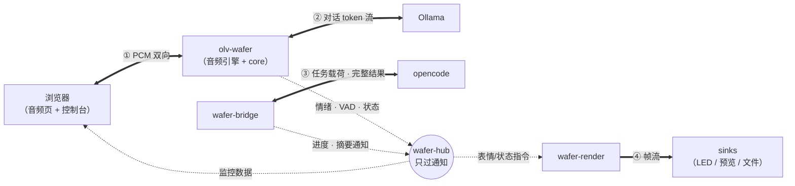
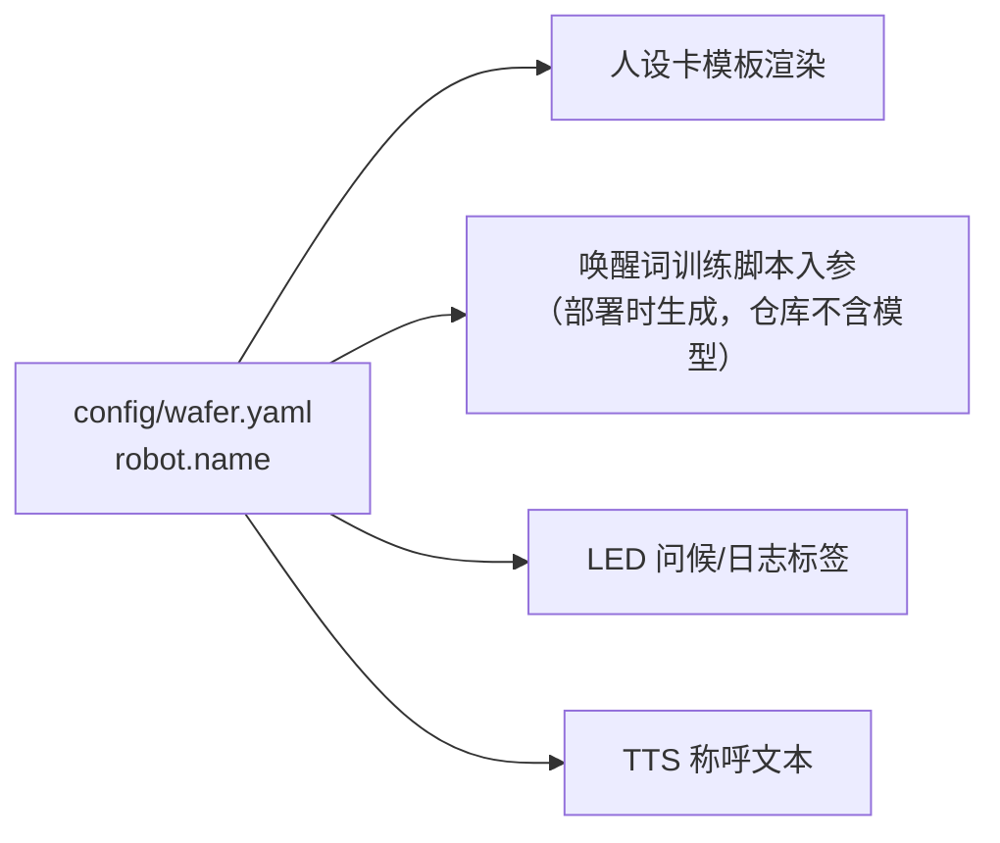

# wafer-pixel 接口规格（SPEC）

> 版本：v1.0（2026-10-23，自设计文档 v1.7 拆分而来——原 §2.3/§3.1/§3.2/§5 契约部分）
> 定位：**技术级 WHAT**——跨模块契约的唯一人读权威（产品级 WHAT 见需求分析报告，机制 HOW 见设计文档与 docs/design/）。
> **权威规则**：`core/interfaces.py` / `core/bus/topics.py` / `render/sinks/pixelbar/protocol.py` 是**可执行权威**，本档是镜像，guard 测试执法；冲突以代码为准，本档同 commit 更新（文档同步 DoD）。
> 章节保留原设计文档编号（§2.3/§3.1/§5.x…）以维持外部引用可追溯；章字母（A-F）为本档结构。

## A. HAL 接口契约（原设计文档 §3.1-§3.2）

### 3.1 接口矩阵

| 接口 | 真实实现 | 模拟实现（开发机/CI） |
|---|---|---|
| `AudioSource` | 浏览器 WebSocket PCM（Edge 音频页） | WAV 文件回放 |
| `VadEngine` | silero-vad **跑在浏览器端**（vad-web，前端已 16k 重采样；服务端 `vad_model: null`，R.13 反查） | fixture 分段时间轴 |
| `WakeWordEngine`（v1.1） | **sherpa-onnx KWS**（拼音 token，零训练，D31；openWakeWord 需训练被否） | 热键/fixture 触发 |
| `SpeakerVerifier` | CAM++（sherpa-onnx 直驱，`engines/voiceprint.py`） | 预计算嵌入向量 |
| `AsrEngine` | **qwen3-asr**（llama-server + mmproj；生产 0.6B Q8 GPU / 开发机 1.7B Q4 CPU；faster-whisper 实测出局） | 转写 fixture + **asr_cache.json 确定性回放**（V.4） |
| `LlmEngine` | llama-server :8080（D40）/ 云端 API（开发机测试，key 运行时读 opencode 配置） | 脚本化 stub（确定应答） |
| `TtsEngine` | TTS HTTP 服务 :9880（独立 venv；**生产 = GPT-SoVITS v2Pro 32k**，`/synthesize` + `/synthesize/frames`；CosyVoice2 保留回退；契约见 §TTS） | 文本捕获 stub / 预生成 WAV |
| `LedSink` | sink-pixelbar：**文本 0xE8（实时）+ 状态灯 0x6B（D39）**；帧 0x17 已弃（D36） | console 帧预览（`/api/frame` HTTP） |
| `TaskRunner` | opencode CLI 子进程（`run --format json`，E.8；MCP/TS 插件方案弃，见 §4.6） | 预置结果事件 stub |
| `HotkeySource` | pynput 全局键盘钩子（wafer-ctl） | fixture 热键脚本 |
| `Notifier` | Windows toast（winotify，wafer-ctl） | 日志打印 |

### 3.2 接口契约（Python Protocol 摘要）

```python
class AudioSource(Protocol):
    async def segments(self) -> AsyncIterator[AudioSegment]: ...
    # AudioSegment: pcm(bytes, 16k mono), start_ts, end_ts

class SpeakerVerifier(Protocol):
    def embed(self, pcm: bytes) -> Sequence[float]: ...     # ~ms level, numpy-free core
    def scores(self, pcm: bytes) -> dict[str, float]: ...   # similarity per enrolled speaker
    # GateResult: verdict(pass/drop/gray), speaker_id, score

class AsrEngine(Protocol):
    async def transcribe(self, pcm: bytes) -> str: ...

class LlmEngine(Protocol):
    async def stream(self, messages: list[Message]) -> AsyncIterator[str]: ...

class TtsEngine(Protocol):
    async def speak(self, text: str) -> TtsStream: ...      # yields audio chunks

class LedSink(Protocol):
    def push(self, frame: Frame, dirty_rect: Rect) -> None: ...
    # frame: 256x32 RGB; dirty_rect for incremental update
```

错误约定：所有实现抛 `WaferError` 子类；编排层捕获后走 §4.8 降级。

## B. 事件总线契约（原 §2.3 + §5.1）

### 2.3 事件总线（wafer-hub）

**面视图**（本系统的第四个正交视图，回答"什么东西在什么路上流"）：内容走点对点专线（数据面，实线），通知走 hub 广播（控制面，虚线）——**hub 上没有任何内容**。



> **实线 = 数据面**（内容专线，点对点，不经 hub）；**虚线 = 控制面**（状态通知，经 hub 广播）。四条专线：① 音频、② 对话、③ 任务载荷、④ 帧流——这张图同时定义了"**什么不允许上总线**"。

主题一览（payload 均为 JSON，schema 见 §5.1）：

| topic | 含义（payload 要点） | 发布者 → 订阅者 | 频率 | 典型场景（谁因此做什么） |
|---|---|---|---|---|
| `audio.state` | VAD 人声起止 `{vad: start\|end}` | olv-wafer → render、gamedog | 事件级 | 你开口 → 眼睛切"雷达脉冲"监听动画；说话结束 → 进门禁/路由 |
| `gate.decision` | 门禁判定 `{verdict, speaker, score}` | wafer-core → render | 每声段 | 主人 0.71 分放行并带身份标签；视频人声 drop 静默丢弃；0.58 落灰区 → 丢弃但 LED 眨"？"（审计由发布方直接落盘，不走总线） |
| `session.state` | 会话状态迁移 `{state}` | wafer-core → render | 状态变更 | 进 thinking → 瞳孔转圈动画；回 standby（v1.1）→ 闭眼打瞌睡 |
| `llm.emotion` | 回复情绪标签 `{tag}` | WaferAgent → render | 每轮 1 次 | 回复带 `[emotion:happy]` → 脸切"开心"宏（眼弧上扬 + 眨眼减半） |
| `tts.amplitude` | TTS 播放音量 `{rms: 0~1}` | olv-wafer → render | 30Hz 节流 | 小饼说话声音起伏 → 嘴部开合（伪口型同步） |
| `task.progress` | 任务进度 `{task_id, phase, detail}` | bridge → render | 事件级 | opencode 在跑 pytest → LED 状态区滚"跑测试中…"，控制台任务面板亮起 |
| `task.permission` | 权限请求 `{task_id, kind, target}` | bridge → render、olv-wafer | 事件级 | 要写 `src/app.py` → LED + 语音"在等你确认"，控制台弹批准按钮（v1.1） |
| `task.result` | 结果摘要 `{task_id, summary}` | bridge → render、olv-wafer | 每任务 1 次 | 修完登录报错 → LED 显示摘要（**不过 core**）；core 收到后只"念"（语音出口） |
| `task.approve` | 权限决议 `{task_id, allow}` | olv-wafer → bridge | 用户确认时 | 语音"允许" / 热键 / 控制台按钮 → 决议回传 opencode，任务继续 |
| `task.cancel` | 取消当前任务 `{task_id, reason}` | wafer-core → bridge | 事件级 | 用户反悔"不对，是这样的…" → 旧 opencode 会话终止，重组修订版重派（D15 修正回路） |
| `mode.switch` | 模式切换 `{mode, tier, source}` | gamedog / 热键 → 全部 | 事件级 | 检测到游戏启动 → render 换 HUD 主题、olv 切陪聊/安静档配置重启 |
| `system.notify` | 系统通知 `{level, text}` | 任意 → wafer-ctl | 事件级 | 组件异常 → Windows toast"小饼打了个盹，日志在 xxx" |
| `render.command` | 渲染指令 `{cmd: error\|scene}` | 任意 → render | 事件级 | 异常降级：显示错误图案 3s → 恢复音箱原生时钟场景 |
| `ctl.hotkey` | 热键 `{key: gate_toggle…}` | wafer-ctl → core、gamedog、bridge | 事件级 | 感冒变声按热键临时关门禁；游戏中手动切换模式 |
| `bench.tick` | 阶段时间戳 `{stage, ts}` | olv-wafer / core → 控制台、日志 | 每轮多打点 | VAD 终点→LLM 首 token→TTS 首音频 → 控制台延迟面板算 P50/P95（§6.4 指标） |

**为什么需要一条独立总线**：五个进程互需对方的运行状态——WaferAgent 出情绪、bridge 出任务进度、gamedog 出模式切换、render 全都要。若点对点直连需要 10 条连接，且每加一个订阅者（如将来的统计页）都要改所有发布方。发布/订阅让组件**只认识 topic、不认识彼此**：发布方 `publish("llm.emotion", ...)`，谁在乎谁订阅——这也是场景回放（§6.3）能无侵入注入事件、模拟舱能整体替换真实后端的结构基础。

设计要点：
- **数据面与控制面分离**：**内容走点对点专线，通知走 hub 广播**。四条数据面专线：① 浏览器 ↔ olv（PCM 音频双向）；② olv ↔ Ollama（对话 token 流）；③ bridge ↔ opencode（任务提示词与完整结果——上 hub 的只有进度/摘要**通知**）；④ render → 各 sink（帧流，sink-web 预览走独立 WebSocket）。声纹门禁所需音频在 olv 进程内直接取得（P1 补丁），同样不经 hub。附带收益：hub 故障时语音对话与任务执行不受影响（仅 LED 状态与监控台冻结），故障域天然隔离；
- **一条消息走哪条面的判定标准**（不是"与音频是否相关"）：PCM/对话/任务载荷/帧是**内容**，audio.state/task.progress 等是**关于内容的通知**——服务于旁观者（render 动画/控制台/LED），若无人旁观，该事件根本不会发布；
- hub 不做持久化，只做转发；断线自动重连；
- 测试模式：hub 可在同一 Python 进程内以 `InProcBus` 替身运行（零端口，场景回放用）；
- `tts.amplitude` 高频话题单独节流队列，防止淹没其他主题；
- 监控台（§4.9）订阅**全部只读主题**用于展示；v1.1 的按钮（任务批准/门禁开关）作为既有主题（`task.approve` / `ctl.hotkey` 等价）的新发布者接入，不新增后端逻辑。

### 5.1 事件 payload 示例

```jsonc
// gate.decision
{ "ts": 1760000000.12, "verdict": "pass", "speaker": "master", "score": 0.71 }
// llm.emotion
{ "tag": "happy", "source": "stream_prefix" }
// task.progress
{ "task_id": "t-20261014-001", "phase": "running", "detail": "bash: pytest -q" }
// task.permission
{ "task_id": "t-20261014-001", "kind": "write", "target": "src/app.py" }
// task.result
{ "task_id": "t-20261014-001", "summary": "已修复登录报错：路径中文导致的导入失败，测试 3 过" }
// mode.switch
{ "mode": "game", "tier": "ghost", "source": "wafer-gamedog" }
```

## C. 共享词汇契约（首次成文，2026-10-23）

<!-- VOCAB_PLACEHOLDER -->

**Route 枚举**（`core/interfaces.py`，路由器唯一输出）：

| 值 | 语义 | 后续动作 |
|---|---|---|
| `CHAT` | 纯闲聊（评分 < S_gray=1.0）| LLM 陪聊 + 情绪标签 |
| `LLM` | 模糊带（1.0 ≤ S < 2.5）| 同 CHAT 处理（v1 不升级派活）|
| `TASK_DIRECT` | 确定编码意图（S ≥ 2.5 或"派活/开工"快车道）| bridge 提交 opencode |
| `TASK_DENIED` | member 的编码请求 | 确定性拒绝（代码拒绝，LLM 仅措辞）|
| `SESSION_END` | 结束词（拜拜/好了/再见/晚安）| 会话回睡 |
| `TASK_AMEND` | 修正线索（不对/不是/说错了/等等/弄错了），**仅任务活跃时** | bridge.amend 重组 |
| `TASK_CANCEL` | 取消线索（取消/算了/停/别弄了/别做了），**仅任务活跃时** | bridge.cancel |
| `TASK_RESET` | 重置线索（新开会话/重头搞/重新开始）| 工作会话重开 |

**SessionState 枚举**（`core/interfaces.py`）：`LISTENING / THINKING / SPEAKING / TASK_RUNNING / STANDBY`（睡眠默认 D22，零转写）。

**情绪标签词表**（D36 定稿 5 词表）：`normal / happy / sad / angry / surprised`——`core/pipeline.EMOTION_TAGS`（LLM 提示词用）与 `render/textface.EMOTION_FACE`（颜文字+颜色映射）**必须同步**，由 `test_textface.py::test_vocab_in_sync` 强制。输出格式 `[emotion:tag]正文`，pipeline 解析剥离后发布 `llm.emotion {tag}`。

**权限角色**：`admin`（chat+coding 全权限）/ `member`（仅 chat），配置于 `speakers.yaml`；路由器与 bridge **双点执行**（闸5/5b）。

**盖章（stamping）**：speaker_id 由 `bridge.submit(transcript, speaker_id, ...)` 附加到任务上——LLM 全程不可见不可控（防伪造，D12）；多人同段按 priority 取最先通过者（主人 > 妻子 > 老人）。

**单任务策略**（BRIDGE-26）：有 held/running 任务时新 TASK_DIRECT 被拒绝并口头询问，绝不静默顶掉。

**task.result 语义**（R.15）：`ok: bool` 必填（成功 True / 失败 False + `error` 摘要）；消费者缺省 ok 为 True（向后兼容）。

## D. 配置契约（原 §5.3）

### 5.3 配置体系

> **现状（v1.5 审计）**：统一 `wafer.yaml` + profiles 的树形配置**未按初版设计实现**——实际为按域分散配置：`config/speakers.yaml`（门禁档案）/ `providers.yaml`（供应商，v1 仅 ghost 占位）/ `projects.yaml`（多项目 D33）/ `inference.yaml`（本地三件套 R.16）/ `mood.yaml`（状态灯 D39）/ `gameapps.yaml`（游戏白名单）；路由规则为 `core/router/scorer.py` 代码默认值（测试锁定，无 yaml）；机器人名在 `core/naming.py`（GUARD-05 守卫）。分散式的好处是每个子系统独立演进、默认值可测；代价是无单一入口。下文初版设计保留作为参考，若配置项继续膨胀可再收敛。

```yaml
# config/wafer.yaml（主配置；profile 覆盖式叠加）
robot:
  name: 小饼            # 唯一名字来源（D-变量化），全链路读取此处
session:
  wake_word_enabled: false   # v1 热键唤醒；v1.1 置 true 加语音唤醒
  timeout_sec: 8
  standby_default: true      # 睡眠默认（D22；常听已删除，此键仅留调试用途）
task:
  default_project: D:/code/wafer-pixel   # 未指明项目时发这里（D18）
  dispatch_grace_sec: 1.5                # 复述播完后的宽限窗（D15；0=立即派发）
providers:
  asr: { impl: faster_whisper, model: small, device: cuda }   # 陪聊档(ghost): int8/cpu
  tts: { impl: cosyvoice, model: 300m }                       # 陪聊档(ghost, v1.1 预留): cosyvoice api；v1 无第二音色（D21）
  llm: { impl: ollama, model: qwen3.5-9b:q4, ctx: 8192 }      # 陪聊档(ghost): dsv4 api
gate:
  enabled: true
  t_pass: 0.62
  t_gray: 0.55
render:
  fps: 30
  sinks: [web]         # 家庭: [pixelbar, web]
hub:
  port: 8765
```

- profiles：`profile.web.yaml`（零硬件默认）/ `profile.pixelbar.yaml` / `profile.game.yaml`（陪聊/安静档参数）；
- `config/speakers.yaml`：见需求 §5.5（name/voiceprint/role/priority）；
- `config/router.yaml`：评分规则与阈值；
- 人设卡模板 `config/persona/persona.md.tmpl`：`{{robot_name}}`、`{{speaker_profile}}`、`{{rolling_summary}}` 三槽位注入。

**名称传播链**：



## E. 数据记录契约（原 §5.2 + §5.4）

### 5.2 审计日志（`logs/audit.jsonl`）

> **现状（v1.5 审计）：未实现**——路由/门禁/工具决策目前无运行时结构化落盘（gate.decision 仅上总线，console 可见但不存档）。"误响应=0"红线由 CI 测试兜底（VE2E-B5 等），但**生产审计追查能力缺失**；建议以 S 级卡补齐（订阅 gate.decision + task.* 落 jsonl 即可）。下文为设计原文。

```jsonc
{ "ts": 1760000001.0, "kind": "route|tool|gate|approve",
  "speaker": "master", "decision": "direct|llm|reject|drop",
  "score": 3.5, "prompt_sha256": "ab12…", "task_id": "t-…", "reason": "verb+object" }
```

### 5.4 记忆档案格式（`config/memory/<speaker>.md`）

```markdown
---
speaker: master
updated: 2026-10-14
---
- 称呼：老板
- 喜欢被吐槽，讨厌说教
- 在做 wafer-pixel 项目；主业后端
- 提醒：腰椎不好，久坐要提醒
```

---

## F. 外部线协议指针

<!-- WIRE_POINTER_PLACEHOLDER -->

**HID 线协议（PixelBar）**：权威 = `docs/PIXELBAR_GUIDE.md`（反编译 + USBPcap 定案：帧格式/CRC/0xE8 文本/0x6B 灯效六区/0x17 弃用判定/校准常量）+ `render/sinks/pixelbar/protocol.py`（可执行权威，黄金报文与厂商 byte-parity 单测执法）。本档不重复抄写。

**opencode 事件流**：JSON lines（`run --format json` 输出），解析权威 = `bridge/opencode_exec.py::parse_event_line`（text/tool_use/step_finish/step_start 四类）；会话续接经 `--session <id>`。

**OLV WebSocket 消息**：入站 `mic-audio-data`（float32/16k/4096 包）/ `mic-audio-end` / `text-input` / `interrupt-signal`；出站 `user-input-transcription` / `full-text` / `audio`（base64 wav 分片，附 `display_text`/`volumes`）/ `backend-synth-complete`——以 fork `websocket_handler.py` 为行为权威，`scripts/verify.py`（smoke/olvloop）为可执行验证。

**本地 TTS HTTP（:9880，`scripts/cosyvoice_server.py`）**

| 端点 | 请求 | 响应 | 说明 |
|---|---|---|---|
| `GET /health` | — | `ok` | 就绪探针 |
| `POST /synthesize` | `{"text","spk_id"?,"text_frontend"?}` | `audio/wav` 整段 | 兼容旧路径（非流式） |
| `POST /synthesize/stream` | 同上 | `audio/L16;rate=24000` **裸 PCM**，连接关闭定界 | 旧约定（无块边界，仅供调试） |
| `POST /synthesize/frames` | 同上 | **帧流**：`u32 BE 长度 + 完整 wav 字节`，`Connection: close` | **R.17 正式路径**；每帧 = 一个分句（逐句非流式合成），可直接播放 |

- 生产 = GPT-SoVITS v2Pro（`scripts/gpt_sovits_server.py`）：`/synthesize` + `/synthesize/frames`，32k；`spk_id`/`prompt_wav` 字段沿用配置但 GPT 适配器用固定 reference。
- CosyVoice2 回退（`scripts/cosyvoice_server.py`）：`spk_id` 为空 = zero-shot 克隆（`prompt_wav`+`prompt_text`），非空 = v1 SFT 内置音色。
- `text_frontend=true` 表示做文本规范化（需要 ttsfrd/WeTextProcessing；缺失时服务端日志 `no frontend is avaliable` 并退化为原文）。
- 服务端内部按标点分句（首句 ≤10 字、后续 ≤40 字），**逐句非流式**合成后再出帧（模型级 `stream=True` 实测更慢且短句无早帧，D45）。
- 在线 TTS（TASK.PROVIDER.02）：`scripts/minimax_tts_server.py` 保持同一 HTTP 契约，调用 MiniMax T2A v2；`voice_id` 原样透传；`tts.provider=minimax` 时由 `serve_inference` 启动。
- 在线供应商配置（TASK.PROVIDER.01）：`config/inference.yaml` + gitignored `config/providers.local.yaml` 合并；密钥只从 `.env`/环境读取；`llm.provider=openai_compat` 时 OLV 使用云端 `/chat/completions`，不启动本地 9B。详见 `docs/design/PROVIDER_API.md`。
