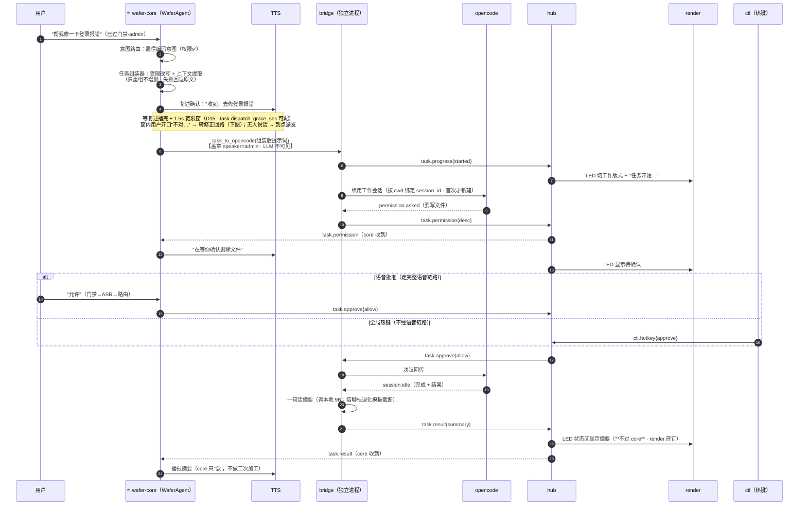
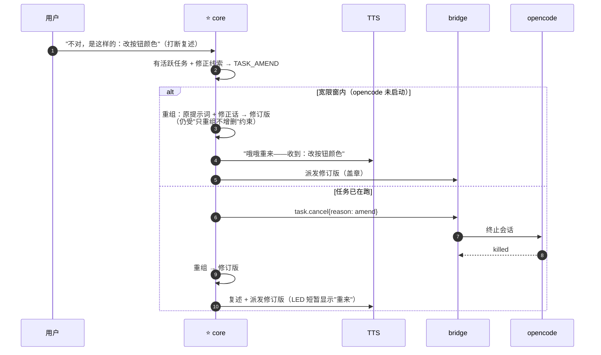

# BRIDGE 模块设计：任务组装·opencode 执行·会话簿·多项目

> 来源：设计文档 v1.7 拆分（原 §4.6 含 §4.6.1 多项目工作台，内容原样迁移）。
> 职责边界：事件契约见 `docs/SPEC.md` §B；决策依据见 DECISIONS（D14-D18/D23/D28/D33）。

### 4.6 opencode 桥（wafer-bridge）

> **实现形态修订（v1.5，依据 D23/D28/W.9/E.8）**：初版设计的"MCP server（stdio）+ TS opencode 插件 + WaferAgent 工具代理"三件套**已被更简路径取代**——PoC #2 落地时发现 `opencode run --format json` 一条 CLI 子进程同时覆盖"驱动 opencode"与"接收事件流"（session ID / 工具调用 / 完成信号全在 JSON lines），TS 插件的全部职责被其覆盖，省掉 TS 工具链与插件 API 版本风险。跨进程通道：bridge 独立进程常驻（D23，游戏模式停 olv 时任务照跑）+ `TASK_REQUEST`/`TASK_RESULT` 走 hub（D28）。**护栏语义不变且更硬**：闸 1 工具白名单从"只挂一个 MCP server"变为**结构性单通道**——代码里只有 `bridge.submit` 一个入口，LLM 连调用工具的机制都不存在；盖章语义保留（speaker_id 随任务传递，LLM 不可见）。下文时序/组装器/修正回路/会话策略的设计语义全部有效，仅"通道物理形态"按本注记理解。

组件拆分（v1.5 现状）：
- **bridge/`server.py`**：Bridge（submit/arm/flush 宽限窗 + amend/cancel 修正回路 + 单任务策略 BRIDGE-26）+ Local/RemoteExecutor（同进程直执 / 跨进程发 TASK_REQUEST）；
- **bridge/`opencode_exec.py`**：OpencodeExecutor——opencode CLI 子进程（`run --format json -m <model>`，模型运行时从本机 opencode 配置解析），事件流解析（text/tool_use/step_finish）+ 会话簿续接；
- **bridge/`composer.py`**：任务组装器（受限改写 + 上下文提取 + 多项目别名文法 D33）；
- **bridge/`service.py`**：BridgeService——独立进程入口（订阅 TASK_REQUEST/TASK_MANUAL），会话簿落盘 `data/session_book.json`；
- ~~MCP server（stdio）~~ / ~~opencode 插件（TS）~~：已弃（上注）。

**任务全生命周期**：



> **core 在本图的六次出手**（居中调度的具体形态）：① 意图路由判定 ② 任务组装 ③ 盖章转交（**复述播完 + 宽限窗之后**才派发，D15）④ 权限语音提醒 ⑤ 语音批准的发布 ⑥ 结果播报。core 不碰的两件事：LED 直显（render 直订，快且不占 core）与 opencode 执行本身（bridge 全权）。

**任务组装器（task composer，D14）**：直通路径在交给 bridge 前经一次**受限的 9B 改写**——输入（转写 + 最近对话上下文），输出结构化任务提示词（目标/上下文/约束三段）。约束：只重组不增删（防幻觉加戏）、保留全部约束词、失败/超时回退原始转写、组装后 TTS 复述一句供用户拦截。价值：①**指代消解**——"把刚才那个问题修一下"只有听过对话的 9B 能解析，opencode 独立无法完成（上下文转移）；②**隐私强化**——传给云端的是组装后的任务提示词而非家庭对话原文（§12#7）。灰区路径无需组装器：WaferAgent 调用工具时天然完成组装。陪聊档下组装器复用同一 LlmEngine（云端模型）。

**修正回路（复述后反悔怎么办，D15）**：TTS 复述不是走过场——**派发安排在复述播完 + 1.5s 宽限窗之后**（`task.dispatch_grace_sec` 可配，0 = 立即）。三层处理：



- 取消线索（"取消/算了/停"）→ TASK_CANCEL：终止任务，不派新任务；
- **防误触**：修正/取消规则仅在活跃任务时生效——日常聊天里说"不对"（反驳小饼观点）走正常闲聊，零影响；
- 无修正线索但新话直达评分且任务在跑 → TTS 询问"停掉重来还是排队"（v1 单任务策略，避免双 opencode 会话打架）；
- 专项规则：**会话重置**（D16）：重置线索（"新开会话/重头搞"）→ TASK_RESET——关闭当前工作会话，下个任务从全新会话开始（任务失败污染上下文时同样适用）；

**会话策略（D16）：持久工作会话，不是每任务新开**。bridge 按**项目目录**维护一个长寿命 opencode 会话——task_to_opencode 默认**续用**该会话，任务上下文在会话内累积："把刚才的再改一下"由 opencode 自己解析（它看着自己刚做的修改）。由此形成**两级上下文，各司其职**：

| 层 | 管什么 | 例子 |
|---|---|---|
| 任务组装器（D14） | **聊天 → 任务**的转移（语音侧指代） | "把**刚才聊天里说的**那个 bug 修一下" |
| 工作会话（D16） | **任务 → 任务**的连续性（执行侧指代） | "**把刚才的**再改一下"（上一个任务的产物） |

- 修正回路（D15）在会话内进行：cancel 当前任务 → 修订版提示词发到**同一会话**（opencode 自然理解"别按刚才说的，改这样"）；
- 游戏（陪聊档）不影响会话——opencode 在云端，本地显存切换与它无关（**游戏挂机跑长任务天然成立**）；
- 会话续用 API 的具体形态并入 PoC #2 验证；若不可续用则退化为每任务新开（连续性降级，功能仍可用）。

**可视驾驶舱（使用场景定稿，D17）**：日常编码姿势 = 左 VSCode + 右 **opencode Windows 应用**（看得见小饼干活的窗口）+ Edge 最小化（音频页与控制台后台常驻，偶尔回来看状态）。语音指令**注入的不是"打字进窗口"，而是与窗口共享同一会话**——语音经 bridge 走 API 进会话，窗口实时显示；你手动打字与语音共存（两只手一个聊天）。实现路径按优先级：

1. Windows 应用连接外部 `opencode serve`（可配置连接地址时最优）：bridge 连同一 server，会话天然共享；
2. 应用内嵌 server 且暴露本地 API：bridge 连其端口；
3. 降级：两套会话分离（应用里你的手动会话 + bridge 的无头工作会话，同项目并行有互踩风险）——缓解：任务时序错开，或用 git diff / VSCode 实时观察小饼的改动。

路径 1/2 成立与否 = **PoC #2 的核心问题**。会话管理语音命令：v1 = "新开会话"（TASK_RESET）+ 状态询问；切换 / 命名 / 列表留 v1.1。

> **窗口与会话的关系**：窗口不是会话，是会话的可选视图——开着，任务出现在窗口里；关着（离开工位/游戏/家人使用），bridge 照常驱动、语音 + LED 承接全部接口。**无头不是被替代的旧方案，而是"没打开视图时的默认态"**；选择哪个视图由"人在哪、眼睛是否空闲"决定，架构对此无感知。

**会话簿归属与 v1 规则（D18）**：

- **为什么在 bridge 不在 core**：会话簿（cwd → session_id 映射）是 opencode 的资源句柄表，属于**机制**，归唯一 opencode 触点（D5 单通道）；core 只发**意图**（派发 / TASK_RESET），不认识 session_id——维持 core 零 opencode 依赖（分层可测，模拟舱可换 stub）。类比：core 是说"重开一个"的经理，bridge 是知道哪个窗口对应哪个工程的操作员。
- **v1 三条规则**：
  1. **每项目一会话**：bridge 按项目目录绑定唯一工作会话（D16 收紧为明规）；
  2. **默认工程**：语音未指明项目 → 发到 `task.default_project` 配置的工程（语义对齐 opencode 不指定目录时的行为）；多项目语音切换（"切到 XX 工程"）留 v1.1；
  3. **手动会话是用户的沙盒**：你在 opencode 客户端手动新建/切换会话，语音**不跟随**——任务永远发到 bridge 绑定的工作会话（确定性优先于"猜测你正在看哪个"）。
- **已知限制（诚实记录）**：你手动切走后，语音任务仍进工作会话——你盯着的窗口可能没动静。缓解：复述确认附会话标记（"发到工作会话"）；客户端会话枚举 API 验证后（PoC #2），v1.1 加"切到刚那个会话"语音命令；
- **bridge 独立进程化 + 会话簿落盘（D23）**：bridge 常驻系统级（不随 olv/模式死活），游戏安静档停 olv 时在跑任务不中断——"挂机跑长任务"的地基；session_id 持久化到磁盘（`data/session_book.json`），bridge 重启/系统重启后续接（顺带解决"关机重启继续昨天的任务会话"）；opencode 插件事件直连 hub 是第二重保险；
- **手动任务的感知与播报（D23）**：驾驶舱里手动打字触发的任务，事件（进度/权限）与结果（摘要）**同样走小饼回流**——LED/通知不分手动还是语音触发（一个管家盯一个工作台）；结果播报默认开、可配置关；游戏安静档自然只有 LED + toast。

**护栏落点对照**（需求 §6.2 六条 → 本设计）：

| 闸 | 实现位置 |
|---|---|
| 1 工具白名单 | OLV MCP 配置仅含本 server；CI 守卫测试枚举工具集 |
| 2 意图路由 | §4.3 评分器 |
| 3 边界提示词 | 人设卡"工作模式"段（模板变量化） |
| 4 结果只读 | 结果事件绕过 LLM 直达 TTS/LED（§4.6 时序"结果回流三步"：摘要→LED 直显→core 播报） |
| 5 身份+权限 | 门禁（前置）+ 路由器校验 + 桥接器二次校验（三点） |
| 6 异常降级 | §4.8 |

**权限交互 PoC 风险**：opencode 权限决议回传 API 需 PoC 验证（并入 PoC #2 三件套，§9）；降级方案：v1 用 permissions 预配置（读类 allow、写/执行类固定策略），高危直接 deny + 语音告知。

#### 4.7 opencode serve 集成与权限语音回路（D51，2026-10-27）

> 取代 `opencode run` 子进程模式（run = 一锤子买卖：自动批准一切权限、零交互事件、stdin 未接）。**实测依据见 DEVLOG 2026-10-27 三连实验 + serve E2E**。

**架构**：
```
bridge ──启动/复用──> opencode serve --port <项目哈希端口>（每项目一实例，懒启动常驻）
  派活    POST /session/{sid}/prompt_async（session 由 SessionBook 复用，D16/D18 语义不变）
  事件    GET /event SSE 长连接 → 事件泵：
            message.part(text)   → 收集最终摘要
            permission.asked     → task.permission{question, diff 摘要} 发布
            session.idle         → task.result 发布
  应答    TASK_APPROVE 订阅 → POST /session/{sid}/permissions/{per_id}
            {"response": "once"（批准） | "reject"（拒绝）}
  取消    TASK_CANCEL → POST /session/{sid}/abort
```

**权限配置**：项目根 `opencode.json` 的 `permission` 字段（**注意：`.opencode/settings.json` 不被加载**——实测教训）。推荐工作台配置：`edit/bash = ask`，读类默认 allow。

**语音回路**（三层）：
1. **即时通道**（权限弹出瞬间）：LED"等你点头哦"（textface）+ 徽章"待决策"（R.21）+ Windows toast（ctl）——三通道已有零新代码；
2. **语音应答**：WaferAgent `pending_permission` 状态（同 pending_clarify 模式）——批准词（批准/同意/可以/通过/准了）/ 拒绝词（拒绝/不行/别改/不要）命中 → TASK_APPROVE{allow}；未命中 → 先播报积压（"有件事等你确认：…"）再处理当轮；
3. **主动 TTS 推送**（待机时唤醒播报）→ **OLVCORE.02 范围**（需 OLV ws 连接注册表 patch，v0.1 后）。

**降级**：serve 启动失败/超时 → task.result{ok:false, "任务失败：serve 未启动"}（铁律 6）；`--serve` 未启用时 bridge 仍走旧 run 执行器（过渡期双模）。

#### 4.6.1 多项目工作台（D33，2026-10-17）

小饼同时服务多个代码项目；每个项目一个持久 opencode 工作会话（D16/D18 现成），切换=移动"当前项目"指针（切走不销毁，切回上下文还在，如电视换台）。

**两级会话概念**（易混淆，明确区分）：（三/四种会话的层级与生灭图见 `docs/design/CORE.md §4.5.5`）

| | 语音会话 | 工作会话（opencode session） |
|---|---|---|
| 角色 | 交互容器：门禁/权限/路由/状态机/即时指代 | 任务容器：项目内跨任务上下文 |
| 生命周期 | 分钟级（唤醒→睡眠） | 天级（跨语音会话、跨重启） |
| 记忆 | pipeline `_recent`（最近 5 条，composer 指代消解） | opencode 自管（db 按 session id），零操心 |

**状态流**：`projects.yaml` 的 `default` 字段（持久化）→ Bridge `current_project`（运行时，`PROJECT_SWITCH` 事件更新）→ 每次任务 `opencode run --session <id>` 且 `cwd=当前项目`。

**切换两入口**（都写 yaml + 发事件 + 反馈）：
1. **console 项目面板**：下拉切换 / 登记新项目（校验路径存在、别名唯一）/ LLM 起名 suggest（预填候选可改，LLM 不可用降级为目录名）；
2. **语音别名文法**（composer 层，确定性匹配）：`在<别名>项目里 / 去<别名>项目 / 回<别名>项目`——命中即剥离短语+切换+播报（"好的，现在我在字幕项目"）；**仅 TASK_DIRECT/RESET 路径生效**（天然 admin-only）；宽限窗内可反悔（AMEND 重新解析项目）。

**三条防污染规则**：
- **切换瞬间清空 `_recent`**：旧项目对话绝不混入新项目任务 prompt；同项目连续指代由 opencode session 兜底（更强的层）；跨项目类比指代（"像刚才字幕项目那样"）不支持——记录在案的取舍；
- **别名未命中→澄清反馈**（不静默）：相似度候选 top3 + 待确认状态（随会话/超时清除），用户确认后用原始任务文本续派；候选相近者排前；
- **默认工作台在仓库外**（`./workspace`）：opencode 的 AGENTS.md 从 cwd **向上查找合并到盘根**，仓库内沙箱会被小饼家规污染；工作台含 git init + 工作台 AGENTS.md（模板入库 `config/workspace_template/`，`scripts/init_workspace.py` 初始化）；随口"跑个测试"落在空工作台而非小饼自己的代码——要她修自己必须明说"在本项目里"。

**其他定稿**：回睡不重置项目（工作台概念跨会话）；登记不强制校验 AGENTS.md/.git（只提示）；切换无二次确认（宽限窗即反悔通道）；手动 opencode TUI 不跟随（D18 不变，同目录可在 TUI session 列表看到语音会话=D17 实时视图）。
