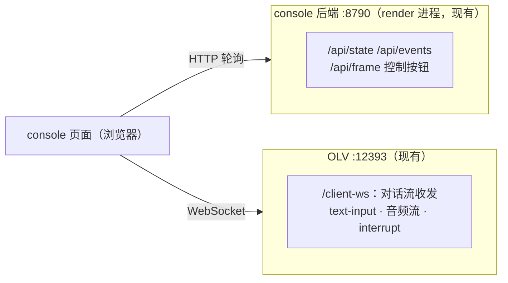

# CONSOLE_UI 控制台 v2 设计：统一交互面（2026-10-26 设计稿）

> 状态：**设计稿待评审**——可视稿 `temp_script/console_v2_mockup.html`（自包含假数据，浏览器直接打开）；本文记录布局/功能/架构与待裁决项。
> 来源：用户提案（2026-10-26）——"最上面是跟 PixelBar LED 一样的显示屏，下面左右分栏，左边对话窗口（同 OLV，支持静音/状态/手动+语音输入），右边状态监视+控制台"。
> 前身：console v1（RENDER_LED §4.9，T6.12/T6.13/D13）+ R.21 状态可见性。

## 1. 布局

```mermaid
flowchart TB
    subgraph TOP["顶部 · 设备镜像（全宽）"]
        LED["PixelBar LED 镜像 256×32<br/>点阵渲染（复用 /compare 技术）<br/>显示设备真实内容：text 模式=颜文字/文字+情绪色<br/>E 模式=槽位表情 · 待机=时钟"]
    end
    subgraph MAIN[""]
        subgraph L["左栏 · 对话（~55%）"]
            ST["状态条（D46 语义：待机/在听/思考/说话/派活中 mm:ss/完成/失败）"]
            CHAT["对话流（气泡：用户右/小饼左+情绪标签）"]
            IN["输入行：文本框+发送 · 🎤语音 · ⏹打断 · 🔊静音"]
        end
        subgraph R["右栏 · 监视+控制（~45%）"]
            CARDS["状态卡 ×6：会话/门禁/任务/模式/LED文本/项目"]
            CTL["控制按钮 ×8 + 🎨表情设计台链接"]
            EV["事件流（滚动）"]
        end
    end
    TOP --> MAIN
```

## 2. 各区功能规格

| 区 | 功能 | 数据源 |
|---|---|---|
| **LED 镜像** | 设备显示的**忠实镜像**（非预览）：text 模式显示 textface 当前内容+情绪色；E 模式显示槽位表情；待机显示时钟 | `/api/state` 的 textface 字段 + `/api/frame`；时钟本地走时（设备断电归零现象可顺带提示） |
| **对话流** | 用户话语（转写）+ 小饼回复（含 `[emotion:]` 标签显示）+ 系统事件行（派活中/打断） | **OLV WS**（见 §3 架构） |
| **文本输入** | 回车/按钮发送 → `text-input` | OLV WS 发送 |
| **语音输入** | 🎤 按下采集 → mic-audio-data/end 流式 | 浏览器 getUserMedia → OLV WS（同 OLV 页协议） |
| **静音/打断** | 🔊 切换音频播放；⏹ 发 interrupt-signal | 本地播放控制 / OLV WS |
| **状态条** | D46 语义（禁裸 Thinking） | hub 事件（现有 `/api/state` 扩展，R.21 已铺） |
| **右栏** | v1 现状平移：状态卡/控制/事件流/项目切换 | 现有 console API 零改动 |

## 3. 架构：页面级双客户端（关键设计）

**console 页面同时连两台服务器**——不加任何后端中转：



- **对话收发零后端改动**：OLV WS 协议已被假浏览器（verify.py）与真前端双向验证过，console 页面作为**又一个 WS 客户端**直接使用
- 语音输入 = 复刻 OLV 页的 getUserMedia→WS 音频路径（协议同款）

## 4. 裁决记录

| # | 问题 | 裁决（2026-10-26） |
|---|---|---|
| ① | console 与 OLV 页的关系 | **并存，OLV 处于灰度状态**——console 为默认主界面（持麦+播音频），OLV 页保留为备用；两页同开时 mic 独占需提示（双流保护） |
| ② | 音频回放归属 | 随 ①——console 持麦时由 console 播 TTS（WS 音频帧→WebAudio）；OLV 页持麦时仍由其播放 |
| ③ | LED 镜像中文渲染 | **默认浏览器字体阈值近似**（真机固件字库不可知，近似可接受）；待定项，不满意再上像素字库 |
| ④ | v1 表情按钮/风格切换器 | 默认移入 /compare（表情设计台是事实归属），右栏只留链接 |

## 5. 调试面板（右栏增强，2026-10-26 用户全项批准）

> 组织原则：**按排障分层组织**（AGENTS 分层排查规范的对偶——每一层给一个"数值判据"的常驻展示）。全部项 approved。

| 组 | # | 信息 | 展示 | 数据来源/改动面 |
|---|---|---|---|---|
| **A 输入诊断**（定位"说了没反应"） | A1 | 麦克风实时电平 | 竖条电平表 + dBFS + VAD 状态点 | console 持麦=浏览器分析器（零后端）；OLV 持麦=OLV 发布 `audio.level`（fork 补丁，5Hz，灰度场景可选） |
| | A2 | 唤醒词检测状态 | "KWS 监听中 · 最近得分 0.31 / 阈值 0.52" | wafer_hooks 低频发布 `kws.status`（变化时或 ≤1Hz） |
| **B 链路耗时**（定位"慢"，§12#2 端到端 ≤2s） | B1 | 本轮处理时间线 | 唤醒→转写→LLM首字→TTS首声 各段 ms 实时点亮；端到端 vs 2s 目标线着色 | **bench.tick 打点**（见 §6）——wafer_hooks + OLV fork 补发布点 |
| | B2 | 历史延迟 | 近 20 轮 P50/P95 sparkline | B1 累积（前端） |
| **C 服务健康**（定位"完全没反应"） | C1 | 服务状态行 | ASR/LLM/TTS/hub/OLV 五点绿红 | console 后端定时探活（/health + TCP 端口），零服务改动；bridge 经 hub 事件新鲜度推断 |
| | C2 | 显存水位 | 进度条 ~10.7/12.3 GB | console 后端 `nvidia-smi` 轮询（无 NVIDIA 则隐藏） |
| **D 任务/会话细节** | D1 | 任务进度卡增强 | phase + 已运行 mm:ss + 各阶段耗时 | task.progress/result（R.21 已铺一半） |
| | D2 | 事件流时间戳列 | HH:MM:SS.mmm | console 后端 events 加 ts（一行） |
| | D3 | 门禁最近得分 | 数字 + 阈值刻度条（pass 0.52 / gray 0.45） | gate.decision 已有 |
| | D4 | 会话超时倒计时 | "回睡还有 3:24" | 后端计时 |

## 6. bench.tick 打点设计（B1 后端）

`core/bus/topics.py` 已预留 `BENCH_TICK = "bench.tick"  # {stage, ts}`。补发布点：

| stage | 发布位置 | 语义 |
|---|---|---|
| `wake` | wafer_hooks `wake_check` 命中时 | KWS 命中（含 `keyword`） |
| `asr_done` | OLV fork（转写完成处） | 转写文本就绪 |
| `llm_first` | OLV fork（LLM 首句产出处） | 首句文本/首 token |
| `tts_first` | OLV fork（首块音频下发处） | 首声出 |
| `turn_end` | OLV fork（本轮播放完） | 回合结束 |

console 前端按 turn（以 wake 为界）聚合，算各段时长与端到端。**注意**：打点走 hub，console 已订阅事件流——零额外通道。

## 7. 实施拆解（评审通过后建卡）

| 卡 | 内容 | 估量 |
|---|---|---|
| TASK.CONSOLE.02 | 页面骨架重构：布局+LED 镜像（textface 驱动）+右栏平移 | M |
| TASK.CONSOLE.03 | 对话流：OLV WS 客户端接入（收发）+文本输入 | M |
| TASK.CONSOLE.04 | 语音输入+音频回放+静音/打断+mic 独占提示（灰度共存） | M |
| TASK.CONSOLE.05 | 调试面板 A/C/D 组（纯前端+后端字段：探活/显存/ts/门禁刻度/倒计时） | M |
| TASK.CONSOLE.06 | bench.tick 打点（wafer_hooks+OLV fork 五点）+ kws.status 透出 + B 组前端 | M |
