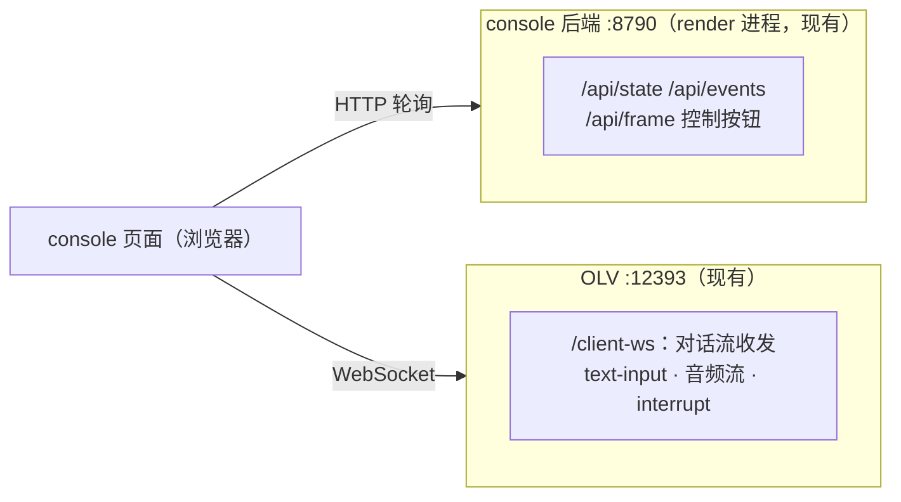
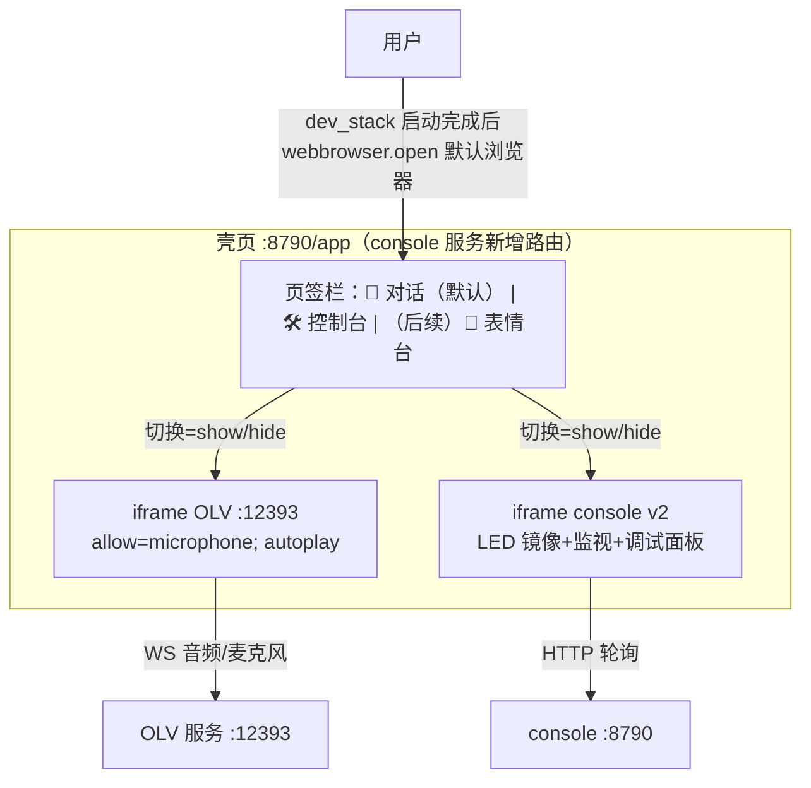
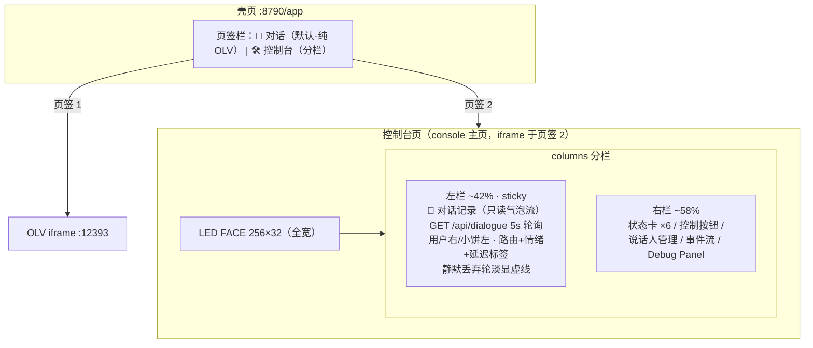
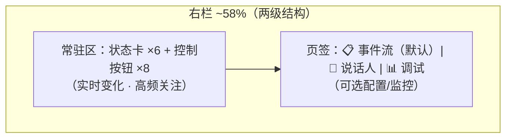
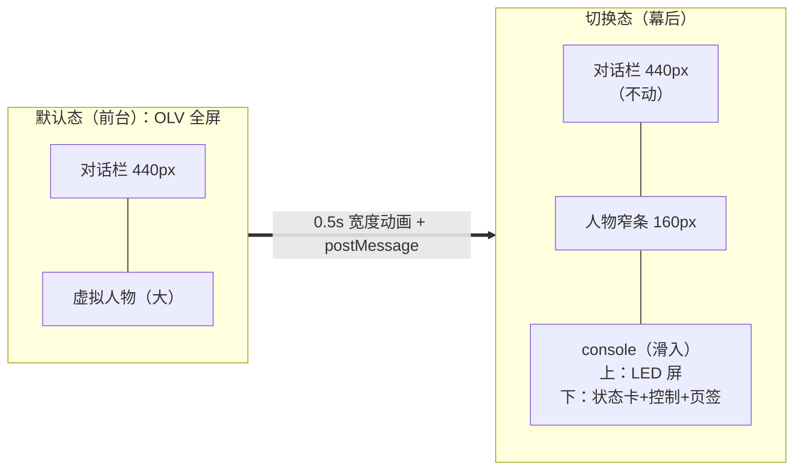

# CONSOLE_UI 控制台 v2 设计：统一交互面（2026-10-26 设计稿）

> 状态：**布局已落地（D63，2026-11-07）**——页签 1 纯 OLV + 页签 2 分栏控制台（顶部 LED + 左对话记录/右功能监控）；左栏从原设计的"交互对话窗口"改为**只读转录流**（数据源 DIALOG.01 日志），交互输入留在页签 1（OLV 不可双开 iframe）。历史设计稿原文保留于下，仅左栏语义被 D63 修订。
> 来源：用户提案（2026-10-26）——"最上面是跟 PixelBar LED 一样的显示屏，下面左右分栏，左边对话窗口（同 OLV，支持静音/状态/手动+语音输入），右边状态监视+控制台"。
> 前身：console v1（RENDER_LED §4.9，T6.12/T6.13/D13）+ R.21 状态可见性。

## 1. 布局

> **D63 修订（2026-11-07）**：左栏落地为**只读对话记录**（转录气泡流，`GET /api/dialogue` ← DIALOG.01 jsonl），不含输入行/语音按钮——交互在页签 1 的 OLV iframe。下图为原设计稿（左栏含输入行部分已被 D63 修订）。

```mermaid
flowchart TB
    subgraph TOP["顶部 · 设备镜像（全宽）"]
        LED["PixelBar LED 镜像 256×32<br/>点阵渲染（复用 /compare 技术）<br/>显示设备真实内容：text 模式=颜文字/文字+情绪色<br/>E 模式=槽位表情 · 待机=时钟"]
    end
    subgraph MAIN[""]
        subgraph L["左栏 · 对话记录（~42%，D63）"]
            ST["状态条（D46 语义：待机/在听/思考/说话/派活中 mm:ss/完成/失败）"]
            CHAT["对话流（气泡：用户右/小饼左+情绪/路由标签+延迟；静默丢弃轮淡显）"]
            LOG["数据源：GET /api/dialogue ← logs/dialogue/*.jsonl（DIALOG.01）"]
        end
        subgraph R["右栏 · 监视+控制（~58%）"]
            CARDS["状态卡 ×6：会话/门禁/任务/模式/LED文本/项目"]
            CTL["控制按钮 ×8 + 说话人管理 + 🎨表情设计台链接"]
            EV["事件流（滚动）+ 调试面板"]
        end
    end
    TOP --> MAIN
```

## 2. 各区功能规格

| 区 | 功能 | 数据源 |
|---|---|---|
| **LED 镜像** | 设备显示的**忠实镜像**（非预览）：slot 模式按 `ExpressionSlotController.current_category` 映射——0 时钟、1 GAME、2-7 对应表情；text 模式的画布镜像待扩展（当前仍由状态卡显示 textface 文本） | `/api/frame` 的 `DevicePreview`（slot） + `/api/state.textface`；时钟本地走时 |
| **对话流** | 用户话语（转写）+ 小饼回复（含 `[emotion:]` 标签显示）+ 系统事件行（派活中/打断） | **OLV WS**（见 §3 架构） |
| **文本输入** | 回车/按钮发送 → `text-input` | OLV WS 发送 |
| **语音输入** | 🎤 按下采集 → mic-audio-data/end 流式 | 浏览器 getUserMedia → OLV WS（同 OLV 页协议） |
| **静音/打断** | 🔊 切换音频播放；⏹ 发 interrupt-signal | 本地播放控制 / OLV WS |
| **状态条** | D46 语义（禁裸 Thinking） | hub 事件（现有 `/api/state` 扩展，R.21 已铺） |
| **右栏** | v1 现状平移：状态卡/控制/事件流/项目切换；控制排含 LLM/TTS 在线/本地、ASR CPU/GPU、🎭 Live2D 形象切换（Hiyori/Mao/DeepSeek-chan/鲸鱼女仆） | `/api/providers` 同步运行时状态；`/api/live2d-model` 代理 OLV `/switch-model` |

## 3. 架构：页面级双客户端（关键设计）

**console 页面同时连两台服务器**——不加任何后端中转：



- **对话收发零后端改动**：OLV WS 协议已被假浏览器（verify.py）与真前端双向验证过，console 页面作为**又一个 WS 客户端**直接使用
- 语音输入 = 复刻 OLV 页的 getUserMedia→WS 音频路径（协议同款）

## 4. 裁决记录

| # | 问题 | 裁决（2026-10-26） |
|---|---|---|
| ① | console 与 OLV 页的关系 | **并存，OLV 处于灰度状态**——console 为默认主界面（持麦+播音频），OLV 页保留为备用；两页同开时 mic 独占需提示（双流保护） |
| ② | 音频回放归属 | 随 ①——console 持麦时由 console 播 TTS（WS 音频帧→WebAudio）；OLV 页持麦时仍由其播放 |
| ③ | LED 镜像中文渲染 | **默认浏览器字体阈值近似**（真机固件字库不可知，近似可接受）；待定项，不满意再上像素字库 |
| ④ | v1 表情按钮/风格切换器 | 默认移入 /compare（表情设计台是事实归属），右栏只留链接 |

## 5. 调试面板（右栏增强，2026-10-26 用户全项批准）

> 组织原则：**按排障分层组织**（AGENTS 分层排查规范的对偶——每一层给一个"数值判据"的常驻展示）。全部项 approved。

| 组 | # | 信息 | 展示 | 数据来源/改动面 |
|---|---|---|---|---|
| **A 输入诊断**（定位"说了没反应"） | A1 | 麦克风实时电平 | 竖条电平表 + dBFS + VAD 状态点 | ✅ 横条版（CONSOLE.10）：浏览器 getUserMedia+AnalyserNode 零后端；真 RMS 输出条不做（跨源不可达） |
| | A2 | 唤醒词检测状态 | "ASR 监听中 · 最近转写『xx』未命中 / 唤醒命中" | ✅（CONSOLE.11）：wafer_hooks 发布 `wake.status`（standby_drop/wake_hit） |
| **B 链路耗时**（定位"慢"，§12#2 端到端 ≤2s） | B1 | 本轮处理时间线 | 四色分段条：ASR / LLM 首字 / LLM 生成 / TTS 首音；黄色粗线标出 TTS 首帧位置 | ✅ CONSOLE.13/24：wafer_hooks 打点 + TTS sidecar；/api/dialogue 聚合 |
| | B2 | 历史延迟 | 近 20 轮 **首帧延迟** sparkline + P50/P95 + 2s 目标线 | ✅ CONSOLE.24：首帧 = asr + llm + tts 首音 |
| **C 服务健康**（定位"完全没反应"） | C1 | 服务状态行 | ASR/LLM/TTS/hub/OLV 五点绿红 | ✅（CONSOLE.05 首版） |
| | C2 | 显存水位 | 进度条 MB/GB | ✅（同上） |
| **D 任务/会话细节** | D1 | 任务进度卡增强 | phase + 已运行 mm:ss | 🟡（R.21 部分：phase+计时；各阶段耗时待 B 组家机打点） |
| | D2 | 事件流时间戳列 | HH:MM:SS | ✅（CONSOLE.05 首版） |
| | D3 | 门禁最近得分 | 数字 + 阈值刻度条（灰/通过分区 + 得分点变色） | ✅（CONSOLE.11）：/api/state 附 gate_thresholds（mtime 缓存） |
| | D4 | 会话超时倒计时 | "回睡还有 3:24"（1s 独立 tick） | ✅（CONSOLE.11）：session.state 附 timeout_s，前端 last_event_t 推算 |

## 6. 单轮阶段打点（B1 后端，CONSOLE.13）

**当前实现**：不新增 hub 通道，使用对话日志 + 同目录 sidecar，避免 OLV/console 额外耦合。

| 字段 | 打点位置 | 语义 |
|---|---|---|
| `asr` | `wafer_hooks.gate_check` 通过点 → `WaferAgent.chat` 开始 | 门禁后到 ASR 文本就绪 |
| `llm_first` | `WaferAgent._chat_llm` 首个非空 chunk | LLM 首 token |
| `llm` | `WaferAgent._chat_llm` 全文完成 | LLM 生成总时长（相对本轮开始） |
| `tts` | OLV `tts_manager` 首个音频入队 → `note_tts_first` | LLM 完成到 TTS 首帧 |
| `total` | 以上合成 | ASR 起点到 TTS 首音 |

- TTS 时间写入 `logs/dialogue/<date>.latency.jsonl`，按 `id` 与主日志合并；主日志保持 append-only。
- 颜色：ASR 橙 / LLM 首字绿 / LLM 生成青 / TTS 首音蓝；条内文字 + 顶部摘要同时显示具体 ms。
- **统计口径（TASK.CONSOLE.24）**：B2 折线图/P50/P95/最大值一律取 **TTS 首帧时间**（`asr + llm + tts`，不是回复总时长）；B1 条形图长度保持整轮分段，用黄色粗线在同一刻度上标出首帧位置，便于直接对比 2s 红线。
- `bench.tick` 仍保留为未来跨进程打点扩展；当前不依赖 hub，避免改变现有事件面。

## 7. 实施拆解（2026-11-06 按 D62 页签壳方案重构）

| 卡 | 内容 | 估量 |
|---|---|---|
| TASK.CONSOLE.02 | **统一入口壳**（D62）：`/app` 页签页 + OLV iframe + 自动开浏览器（见 §8） | S |
| ~~TASK.CONSOLE.03~~ | ~~对话流：OLV WS 客户端接入~~ | **被 D62 取代**（OLV iframe 即对话 tab） |
| ~~TASK.CONSOLE.04~~ | ~~语音输入+音频回放自建~~ | **被 D62 取代**（复用 OLV 成熟音频链） |
| TASK.CONSOLE.05 | 调试面板 A/C/D 组（纯前端+后端字段：探活/显存/ts/门禁刻度/倒计时） | M |
| TASK.CONSOLE.06 | bench.tick 打点（wafer_hooks+OLV fork 五点）+ B 组前端 | M |
| TASK.CONSOLE.07 | 说话人管理面板（`/api/speakers` + 浏览器录音注册，2026-11-07 ✅） | S |
| TASK.CONSOLE.08 | **控制台左右分栏改版**（D63）：`GET /api/dialogue` + 左栏转录气泡流 + 右栏全部现有功能（2026-11-07 ✅） | M |

## 8. 统一入口壳：页签架构（D62，2026-11-06 用户设计）

> 用户裁决：OLV 界面与 console 整合为**一个窗口、顶部页签切换**；服务启动后**默认浏览器**自动打开（不再是 Edge app 直开 OLV）。
> **架构简化**：对话 tab 直接 iframe 嵌 OLV（其 CORS `allow_origins=["*"]`、无 X-Frame-Options，实测可嵌）——原 CONSOLE.03/04 的"自建对话客户端/自建语音输入"整体取消，省两张 M 卡。



**规格**：
1. **壳页**由 console 服务新增 `GET /app`；两个 iframe **同时常驻**（页签切换只 show/hide，OLV 的 WS/麦克风连接不断——切到控制台再切回，语音会话不中断）
2. **麦克风权限**：OLV iframe 加 `allow="microphone; autoplay"`；首次加载浏览器对 `:12393` 源弹权限，一次授权持久（localhost）
3. **自动打开**：dev_stack 全部端口就绪后 `webbrowser.open("http://127.0.0.1:8790/app")`（默认浏览器）；`--no-olv` 时壳页对话 tab 指向的 OLV 不存在——页签保留，iframe 加载失败显示占位提示
4. **默认 tab = 对话**（OLV）——日常主入口；控制台 tab 按 §1-2 设计渐进重排
5. OLV 页内已有的状态徽章（R.21 overlay）在 iframe 内照常工作

## 9. 分栏改版（D63，2026-11-07 用户裁决）

> 用户指令："第一个页签是纯粹的 OLV 界面，第二个页签是我们左右分栏的控制台，最上面还是那个 LED 屏幕"——v2 设计稿的布局诉求在页签 2 落地。



**要点**：
1. **左栏是记录不是输入**：交互（语音/文字输入/打断）留在页签 1 的 OLV iframe——OLV 不可双开（两个 iframe = 双 WS 连接，会话状态混乱），左栏改为消费 DIALOG.01 转录日志（`GET /api/dialogue?limit=120`，按日文件，静默丢弃轮也可见 = 排障价值）
2. **只重渲染新轮**：前端以 count 变化判断，滚动接近底部才自动跟随（用户上翻历史时不打扰）
3. **左栏 sticky**：右栏内容长需要滚动时，对话记录贴顶常驻；≤960px 窄屏自动退化为上下堆叠
4. **路由标签中文化**：13 路由 → 聊天/派活/修正/取消/权限/澄清/静默丢弃/未唤醒……一眼可读
5. **历史日期可查**：API 支持 `?date=YYYY-MM-DD`（前端暂只用今天，翻历史留给后续）
6. **右栏两级结构（2026-11-07 用户反馈追加）**：上部常驻（状态卡 ×6 + 控制按钮——实时/高频），下部页签（📋 事件流[默认] / 👥 说话人 / 📊 调试——可选配置/监控）；原右下角裸样式 Debug Panel（非 .card，border-top 分隔，风格突兀）收进调试页签一并消除；麦克风电平（A1，未实现）做好后进常驻区



## 10. 舞台式切换（D64，2026-11-07 用户设计）

> 取代 §9 的分栏方案：console 不再有独立形态，**唯一入口 `/app`**，双 iframe 宽度动画实现"前台/幕后"舞台切换。§9 的对话记录面板随 D64 移除（OLV 对话栏即实时对话），`GET /api/dialogue` API 保留（数据源不变，翻阅历史留作后续）。



**实现分层**：
1. **壳页**（`render/console/app.html`）：`.views` flex 双 iframe；`body.narrow` 下 `#v-chat` 宽 `max(600px, 50%)`（至多半屏、不低于 OLV 桌面断点）、`#v-ctl` 占余宽；`<700px` 窄窗格降级为整页切换（OLV 移动断点会卸载聊天面板）。
2. **OLV**：**零注入**（2026-11-07 修订）——半屏 1024px 下 OLV 原生响应式：对话栏 440 + 输入条/麦克风在面板内右下自适应。曾实现 layout_switch.js 注入 dock 方案，实测三坑（transform 祖先劫持 fixed / css-in-js 哈希类名不稳定 / OLV index.html 无 no-cache 缓存）后用户裁决移除——收益不抵运维。
3. **console 页面**（`index.html`）：上下单列（LED → 状态卡 **3×2 固定网格** → 控制按钮 → 页签），无 max-width 限制（全宽利用）；对话记录面板移除。

**实测验证**（Playwright，2026-11-07）：2048px 屏 narrow 态 1024/1024 各半 ✓；状态卡 3 列等距（16/351/685）每行等高 ✓；OLV 桌面布局保持（chatVisible）✓。注意：后台浏览器 CSS transition 被节流会造成宽度测量假象（测量需等待渲染帧）。

**运维**：无 OLV 注入（layout_switch 已退役；status_overlay 独立，重装 OLV 后按需重跑 `apply_status_overlay.py`）。

