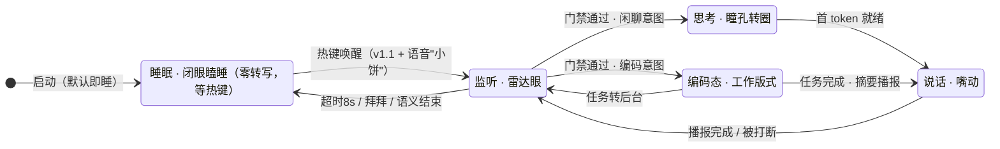
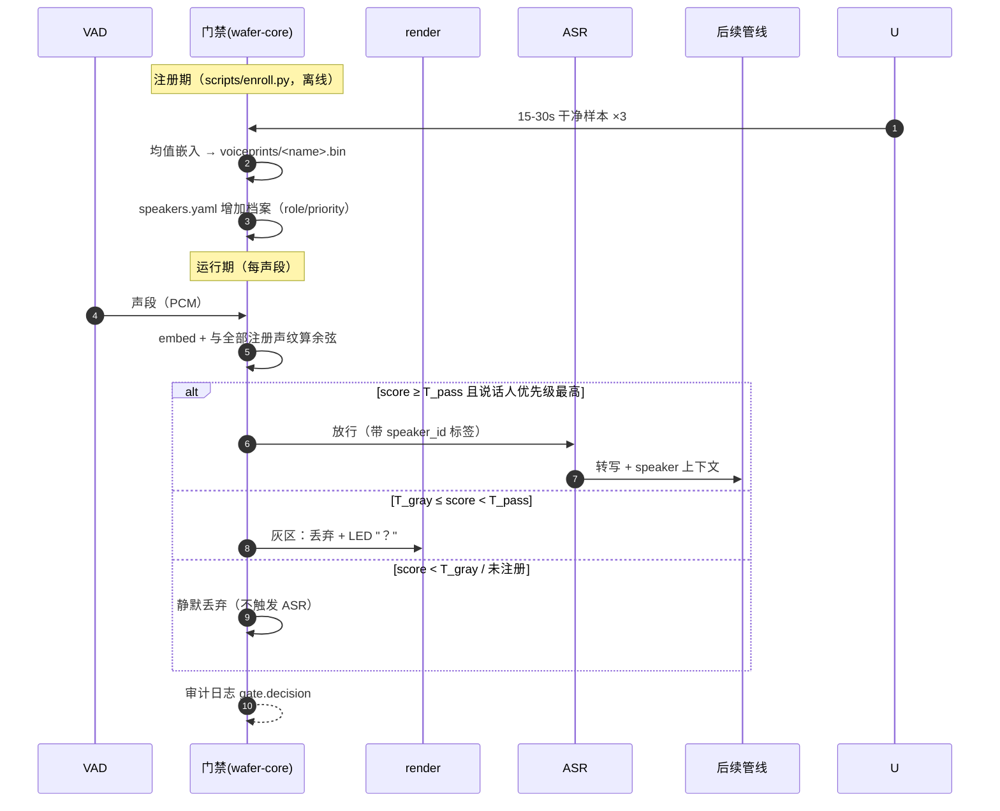
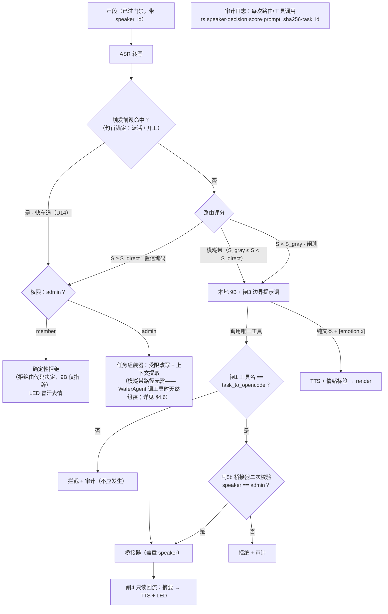
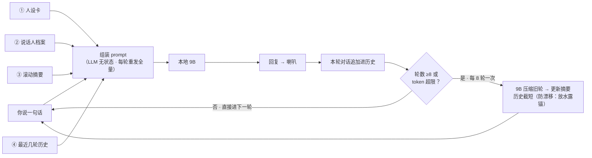
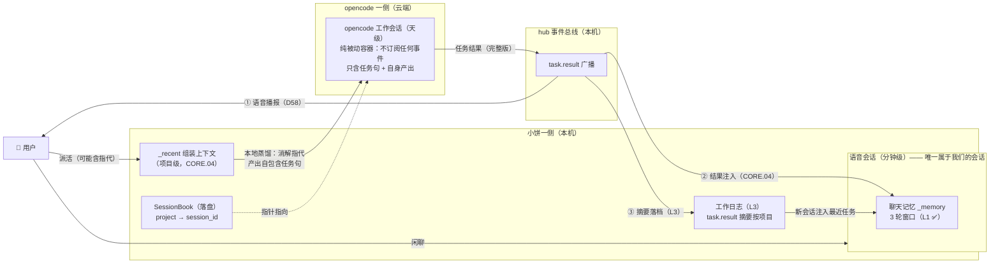
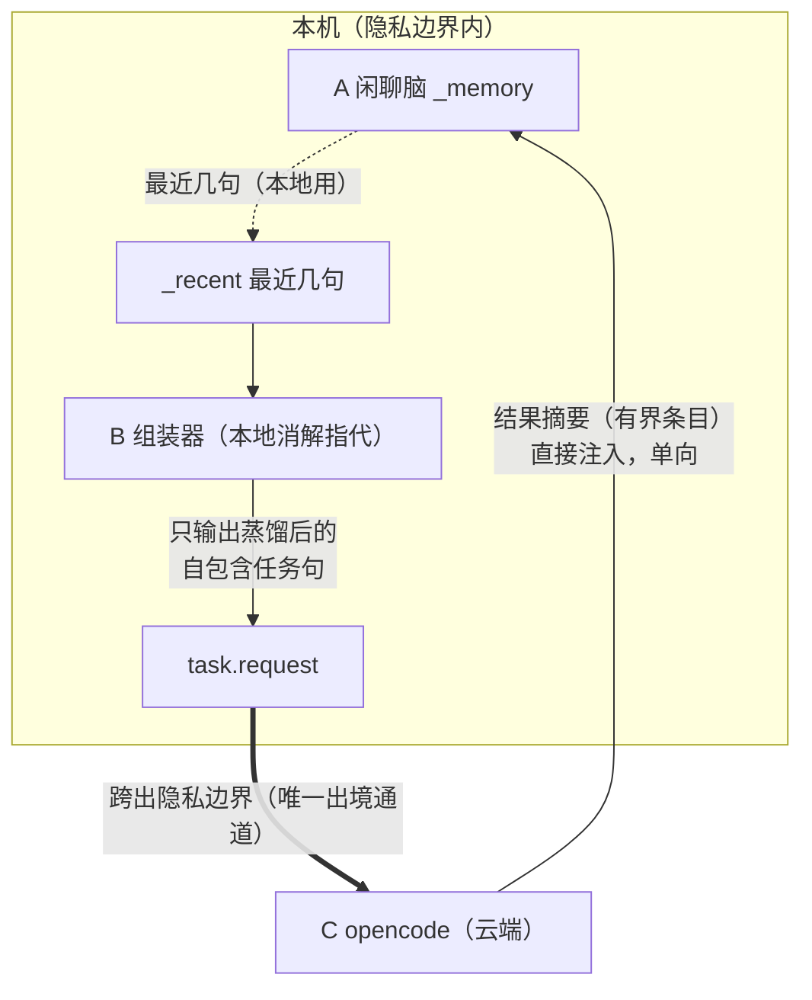
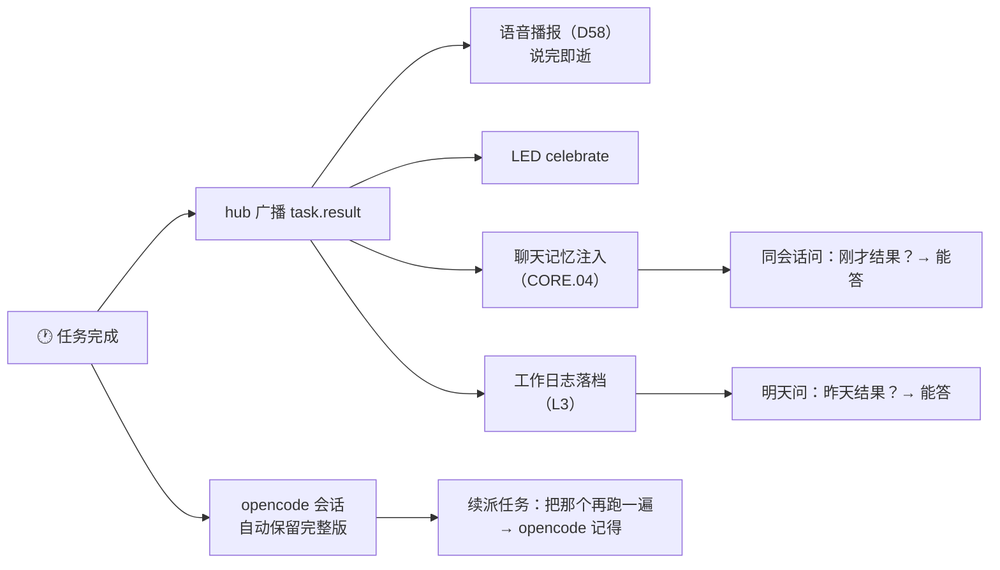

# CORE 模块设计：会话·门禁·路由·记忆

> 来源：设计文档 v1.7 拆分（原 §4.1-§4.4，内容原样迁移；章节保留原编号以维持外部引用）。
> 职责边界：接口契约见 `docs/SPEC.md`；为什么这么设计见 `docs/DECISIONS.md`；本档只讲机制（HOW）。

### 4.1 会话管理器

**v1 状态机（睡眠默认 + 热键唤醒，D22）——壳与主循环一体，五个状态**：



- **任务完成自动唤醒**：睡眠中后台任务完成 → 睤眼播报 → 8s 无新输入回睡（"管家主动汇报"）；
- **唤醒方式**：v1 = 热键（ctl，可配置键位）；v1.1 = + 语音唤醒词（openWakeWord + P5 补丁）；**常听模式已删除**（D22：误触家人对话/心理不安/任务误触发三重风险）；
- **睡眠 = 零转写**：浏览器麦克风保持授权打开（页面常驻），但音频不进任何处理管线——不切段、不转写、不存（逻辑零转写；"物理静音"= 待机时停 track，留实测后定）；
- 两个**不改变状态**的静默情形（图上不画）：门禁未通过（drop/灰区）→ 留在监听、零输出；member 编码请求 → 拒绝话术走 Speaking；
- **结束信号**（优先级从高到低）：口头"拜拜/好了"（路由专项规则）→ LLM 回复尾随 `[end]` 标志 → 8s 超时；
- **打断**：Speaking 态下 VAD 检测人声 → 立即停 TTS → 回 Listening（OLV 原生能力）。

### 4.2 声纹门禁与权限档案



- 多人同段：取**注册优先级**（priority 小者优先）中得分最高者；均不过 → 按灰区/丢弃处理（§12#5）；
- 阈值：`T_pass`/`T_gray` 配置化，初值 0.62/0.55（CAM++ 余弦，**待家庭实测标定**）；离线评估用合成测试集（§6.2）；
- 热键兜底：全局热键临时 `gate.enabled=false`（感冒/变声）；
- 权限档案：`speakers.yaml`（schema 见 §5.3）；`role: admin` = chat+coding+opencode，`role: member` = 仅 chat。

### 4.3 意图路由器与护栏

**术语与符号（本节读图须知）**：

| 术语 | 含义 |
|---|---|
| **S（评分）** | 对一句话的"编码意图"打分：按下方规则表累加的纯数字 |
| **S_direct = 2.5** | 直达阈值：S ≥ 2.5 → 判定"确定要干活"，跳过 9B 直送 opencode |
| **S_gray = 1.0** | 模糊阈值：S_gray ≤ S < S_direct → **模糊带**，交给 9B 判断（它手里有转交工具） |
| **模糊带** | [S_gray, S_direct) 分数区间。⚠️ 与**声纹灰区**（§4.2）是两个概念：模糊带的请求**会被继续处理**（9B 接手），声纹灰区的声音**被直接丢弃**（只是眨个"？"）——两个"中间地带"，两种命运 |
| **admin / member** | 说话人权限角色（speakers.yaml，§4.2）：admin = 主人全权限；member = 家人仅聊天 |
| **闸N** | 护栏编号（需求 §6.2 共六条，§4.6 有落点对照）：闸1 工具白名单 / 闸2 意图路由（本节）/ 闸3 边界提示词 / 闸4 结果只读回流 / 闸5 身份门禁与权限（5b = 桥接器二次校验）/ 闸6 异常降级 |
| **盖章** | WaferAgent 在工具调用上附加已验证的 speaker 身份——LLM 看不见也改不了（§4.6） |
| **审计日志** | 每次路由/工具决策的结构化记录（ts·speaker·decision·score·prompt_sha256·task_id，§5.2）——调试数据 + 将来的升级训练集 |
| **TASK_DIRECT 等** | 路由结果的枚举值（§3.6 代码）：CHAT 纯闲聊 / LLM 模糊交 9B / TASK_DIRECT 直达 opencode / TASK_DENIED member 被拒 / SESSION_END 会话结束 / TASK_AMEND 修正当前任务 / TASK_CANCEL 取消当前任务（后两者仅在活跃任务时触发，D15）/ TASK_RESET 重置工作会话（D16） |

**评分怎么算——三句话实测**（对照下方规则表）：

| 你说的话 | 命中 | S | 去向 |
|---|---|---|---|
| "帮我修一下登录报错" | 修（动词）+ 报错（宾语）+ 帮我（语境）+ 组合加成 | 1+1+0.5+1 = **3.5** | ≥ 2.5 → 直达 opencode |
| "我昨天看了本讲 git 的书" | git（宾语） | **1.0** | 模糊带 → 9B 判断（大概率聊书不转交） |
| "今天好累啊" | 无命中 | **0** | 纯闲聊 |
| "派活，把刚才那个问题弄一下" | 触发前缀"派活"（句首） | 免评分 | **快车道直达**；"刚才那个"由组装器消解（§4.6） |



**路由评分规则**（`config/router.yaml`，全部确定性）：

| 类别 | 示例 | 分值 |
|---|---|---|
| 动作动词 | 写/改/修/跑/执行/部署/编译/重构/提交/安装 | +1.0 |
| 编码宾语 | 代码/文件/函数/接口/报错/bug/测试/脚本/项目/git | +1.0 |
| opencode 语境 | 帮我/让它/交给/任务 | +0.5 |
| 强信号组合 | 动词+宾语同时命中 | +1.0 加成 |

- 阈值：`S_direct=2.5`（含组合加成即达），`S_gray=1.0`；
- 专项规则：口头结束词（"拜拜/好了"）→ 会话结束，不进 LLM；
- 专项规则：**触发前缀快车道**（句首锚定，默认 `["派活", "开工"]`，`router.yaml` 可配）→ 无视评分直达 TASK_DIRECT（权限校验照过）——给用户 opt-in 的 100% 确定性，自然语言瀑布照常兜底，两者并存（D14）；
- 专项规则：**唤醒词分流（D48，2026-10-25）**：待机 KWS 命中「小饼干活」→ 唤醒并**强制任务路由**（剥离唤醒词，跳过评分）；同句带任务则直接提交，只唤醒则回"好，说吧"并置 `pending_work`（下句直达派活，即使无动词）；「小饼小饼」命中 → 正常唤醒，不动路由。词表两行在同一 `keywords.txt`，`wake.word{keyword}` 记录命中词；
- 专项规则：**任务修正 / 取消**（仅当有活跃任务时生效，D15）：修正线索（不对/不是/说错了/等等）→ TASK_AMEND；取消线索（取消/算了/停）→ TASK_CANCEL；无修正线索但新话直达评分且任务在跑 → TTS 询问"停掉重来还是排队"（v1 单任务策略）；
- 专项规则：**会话重置**（D16）：重置线索（"新开会话/重头搞"）→ TASK_RESET——关闭工作会话，下个任务全新开始（详见 §4.6 会话策略）；
- 每条规则、阈值均可在 CI 中用 fixture 断言（§6.4）。

**设计依据（两级瀑布，业界同构）**：路由不是纯关键词——**模糊带交给 9B 判断**（它持有唯一工具），关键词只处理高置信直达。不让 9B 全程路由的理由：①延迟账——9B 一次路由决策 0.5~1.5s，吃光每轮 ≤1.5s 的预算，规则评分 <1ms；②可测性——规则是纯函数可 CI 断言，LLM 判断随采样漂移。错误代价不对称：误报（闲聊当编码）靠组合阈值压制，漏报（编码进闲聊）无害——模糊带 9B + 唯一工具双重兜底。与 Home Assistant 语音管线（模板意图优先 + LLM 兜底）同构，属本地助手场景主流方案。

**升级路径**：审计日志即训练数据积累器——若误路由多，依次升级：扩词表（改 YAML）→ 用日志训小分类器替换规则层 → 陪聊档由云端大模型路由；只换第一级，架构不动。

### 4.4 记忆管理

> **现状（v1.5 审计）**：本节设计仍是 v1.2/M7 的计划，**生产链路未接线**——`MemoryManager`/`SpeakerMemory` 已实现（M2/T2.5，`core/memory/`），滚动摘要/persona 模板/`config/memory/` 目录/清理脚本均未创建。多轮记忆整体归 v1.2 陪聊档（D30 用户裁决顺延）。**2026-11-06 更新**：CORE.02 已在 WaferAgent 侧接通**短窗口**（`_memory` 最近 3 轮注入 `_chat_llm`，会话边界 5min/拜拜，见 §4.5）；本节滚动摘要仍是长期方向。下文为设计原文，保留作为 M7 实施依据。

**OLV 自带什么 / 我们补什么**：OLV 自带人设卡（随每次请求发送）与聊天记录持久化（可续聊）；v1 的长期记忆模块官方已暂时移除，且无按人记忆、无滚动摘要——本节补齐这三样。业界方案光谱：滑动窗口（丢旧信息）→ **滚动摘要（本方案：旧轮压缩 + 保留近窗）** → 向量记忆 RAG（Mem0/Letta，强但重，留 P2）。

**每轮发生什么（从你说的一句话开始读）**：



**四份材料的存储位置**（图外信息）：

| 材料 | 位置 | 说明 |
|---|---|---|
| 人设卡 | `config/persona/persona.md.tmpl` | 模板渲染（`{{robot_name}}` 等变量） |
| 说话人档案 | `config/memory/<speaker>.md` | 事实/偏好/提醒，与声纹身份对应 |
| 滚动摘要 | `data/summaries/<session>.md` | 每 8 轮重建 |
| 全量历史 | `data/sessions/<date>.jsonl` | 完整留档，**永不进 prompt**（仅审计/回看） |

- 注入预算：人设卡 ≤1.5K + 档案 ≤0.5K + 摘要 ≤0.5K；
- **人设漂移与摘要的关系**：LLM 无状态，人设卡在**每次请求**的上下文里（客户端每轮重发全量），不存在"中途掉出"；漂移主因是长历史**稀释**了系统提示的影响力。每 8 轮的滚动摘要把历史截短 → 人设卡相对权重回升——防漂移靠"放水露锚"，不是"重新抛锚"。若实测仍漂移，进阶手段是在历史中段插一条系统提醒消息（按实测决定，不预先设计）；
- 清理：`scripts/cleanup_history.py --before <date>`（§12#7）；
- 摘要生成失败 → 退化为"最近 N 轮原文截断"，不阻塞对话。

### 4.5 上下文与会话管理（2026-11-06 重整：五轮讨论定稿）

> **北极星需求（用户原话）**："小饼像真正的助手——陪聊天、随时开工，工作和聊天都记得，任何时刻开口都接得上。"
> 本节用五张图回答五个递进的问题：**谁拥有什么**（4.5.1）→ **容器怎么摆**（4.5.2）→ **各自看什么**（4.5.3）→ **怎么互通、隐私边界在哪**（4.5.4）→ **结果去哪了**（4.5.5）；最后是**边界规则表**（4.5.6）和**实现路线**（4.5.7）。
> 术语定稿：**"工作会话" = opencode 自己的会话**（同一东西两个名字，D16/D18）。小饼**没有**自己的工作会话。

#### 4.5.1 心智模型：一个秘书和一个外聘专家

**小饼是秘书，opencode 是外聘专家。**

- 专家的项目档案（工作会话）在专家自己那里——他干活需要完整上下文（文件/工具调用/报错），重复维护一份等于双份簿记加永远的同步问题（D16/D18："opencode 自管，零操心"）；
- 秘书自己记的是：**专家的通讯方式**（SessionBook 指针）、**每次汇报的摘要**（工作日志）、**自己和老板的聊天**（语音会话 + 聊天记忆）；
- 老板问"上次专家说了什么"，秘书翻自己的摘要本——不需要把专家的整个档案搬过来。

**资产清单**（谁拥有什么，代码事实）：

| 资产 | 归属 | 性质 | 寿命 |
|---|---|---|---|
| 语音会话（`_SessionMode`） | 小饼 | **唯一属于我们的会话** | 分钟级 |
| └ 聊天记忆（`_memory`） | 小饼 | 语音会话的短期工作记忆（L1 ✅） | 随语音会话生灭 |
| SessionBook | 小饼 | **指针簿**（project → opencode session_id），不是会话 | 天级落盘 |
| 工作日志（L3 待建） | 小饼 | task.result 摘要存档，**不是会话** | 7 天滚动 |
| `_recent`（CORE.04 接活） | 小饼 | 组装器的指代消解上下文 | 项目级 |
| **opencode 工作会话** | **opencode** | 任务对任务的真实上下文（完整版） | 天级，跨重启 |
| 手动 opencode 会话 | opencode | 驾驶舱手动开的，语音不跟随（D18） | 不定 |

#### 4.5.2 容器总览：一张图看全貌

**三个独立容器，谁也不装着谁**（仅寿命不同）；互通靠事件总线 + 日志，不靠会话打通。



#### 4.5.3 三段上下文流：各自看什么

| 流 | 载体 | 窗口 | 看得到 | 看不到 |
|---|---|---|---|---|
| **A 闲聊脑**（本地 9B） | `_memory` | 最近 3 轮 | 人设 + 闲聊 + 注入的任务结果条目 | 任务的完整执行过程 |
| **B 任务组装器**（纯规则） | `_recent` | 设计上限 5 条 | 最近几句（**本地消解指代用**） | ⚠️ 死代码，CORE.04 接活 |
| **C opencode 会话**（云端模型） | opencode session | 项目内跨任务 | 任务句 + 自身完整产出 | 闲聊内容（隐私设计，**正确**） |

#### 4.5.4 桥：单向注入 + 本地蒸馏（隐私边界）

**两条桥的规则**：工作内容可以进闲聊（直接注入）；闲聊只允许"本地蒸馏"进工作——**闲聊原文永不出本机**（D14 护栏）。



**D14 红线（CORE.04 修复项）**：`bridge/composer.py::_build_prompt` 现实现会把 `Recent context` **原文附录**拼进发给 opencode 的 prompt——若直接接通 `_recent`，闲聊原文将随任务出境。CORE.04 实施时必须改为：`recent_context` 仅在本地消解使用，prompt 只含消解后的自包含句。

#### 4.5.5 结果的一生：task.result 的完整旅程



**什么时候问、谁能答**：

| 时间点 | 问法 | 靠什么 | 状态 |
|---|---|---|---|
| 同一会话内（<5min） | "刚才结果是多少？" | `_memory` 注入条目 | CORE.04 |
| 跨会话（同天/隔天） | "昨天那个结果再说一遍" | 工作日志注入 | L3 |
| 同项目再派活 | "把那个测试再跑一遍" | opencode session 续接 | ✅ 现有 |
| 跨项目 | — | 不知道（D33 隔离，正确） | — |

#### 4.5.6 会话边界：事件 × 状态影响表

| 事件 | 语音会话 | 聊天记忆 | _recent | opencode 会话 |
|---|---|---|---|---|
| 5 分钟无语音 | 关闭（回待机） | **清空** | 保留 | 不受影响（挂机任务继续，D23） |
| 说「拜拜」 | 关闭 | **清空** | 保留 | 不受影响 |
| 项目切换（D33） | 不变 | 不变 | **清空** | **指针切换**（每项目独立） |
| bridge／系统重启 | 消失 | 消失 | 消失 | **续接**（SessionBook 落盘） |
| 任务完成 | 不变 | **注入结果条目**（CORE.04） | 不变 | 被动保留 |

#### 4.5.7 记忆五层模型（实现路线，2026-11-06 补重启恢复与容量参数）

```
L1 会话内窗口     最近 3-5 轮原文           ✅ CORE.02 已做（3 轮，可扩 5）
L2 会话摘要       会话结束时 9B 压缩存档；    ★ v0.2——新会话注入最近摘要
                 新会话自动注入
                 + 重启恢复（两层落盘，见下）
L3 工作历史       task.result 摘要按项目     ★ v0.2——"昨天干了什么活"能答
                 存日志，闲聊注入最近几条
L4 说话人档案     按人的事实/偏好，永久       v0.3（M7 §4.4 原设计）
L5 向量检索       "上周说的那个"精确翻旧账    P2 不做
```

**L2 重启恢复设计（2026-11-06 用户需求）**——落盘分两层，重启后精确接续：

| 层 | 落盘内容 | 回答什么 | 文件 |
|---|---|---|---|
| 摘要层 | 每个语音会话结束时的 ~100 字压缩 | "昨天聊到哪了" | `data/memory/summaries/` |
| 原文层 | 重启前 `_memory` 的最近 N 轮**原文** | "咱们刚才说到哪了"（精确接上最后一句） | `data/memory/last_session.json` |

重启后新会话注入 = 跨天摘要（摘要层）+ 最近任务（L3）+ 重启前最后 N 轮原文（原文层）。
实现选择：**自己落盘**（`data/memory/`，格式可控）；`set_memory_from_history()` 保持 no-op（依赖 OLV 内部格式，上游改格式就断）。

**记忆容量参数（2026-11-06 评估）**：

| 部署档 | ctx | 记忆窗口 | 摘要范围 | 隐私 |
|---|---|---|---|---|
| 本地 9B @ 8K（默认） | 8192 | 3-5 轮 | 7 天 | ✅ 全本地 |
| 本地 9B @ 16K | 16384 | 8-10 轮 | 30 天 | ✅ 全本地（TTFT +0.5s） |
| 在线 API | 64K+ | 20+ 轮 | 90 天 | ⚠️ 注入的记忆全部出境 |

- 上下文**不是显存瓶颈**（8K→16K 仅 +90MB KV，D40 实测）；真正的限制是 9B 的注意力稀释和 TTFT
- ASR 进 CPU（D40 补丁）释放的 1.6GB 给模型权重和稳定性余量，与上下文无关；TASK.VOICE.06 起可在控制台切到 GPU（实测 0.6B Q8 中位 0.446s → 0.250s，约 1.8×，代价是额外显存）
- 在线 API 放大记忆时的隐私代价：聊天摘要原本"全本地"，注入在线请求即出境——届时需加本地压缩过滤（v0.3 话题）

**v0.2 范围**：L1（✅，3→5 轮）+ CORE.04（当前任务结果注入 + `_recent` 接活 + D14 泄漏修复）+ L2（会话摘要 + 重启恢复两层落盘）+ L3（工作日志）。
**验收标准（一句话）**："任何时刻对小饼说'咱们刚才/昨天说到哪了''昨天那个任务结果再说一遍'，它都能接上，且所有记忆不出本机。""
