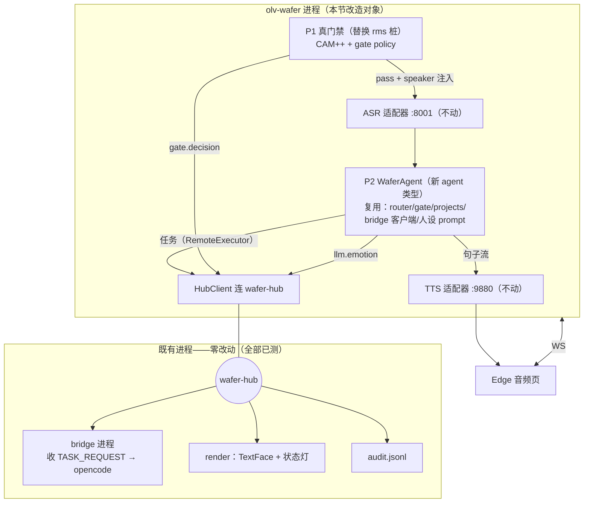
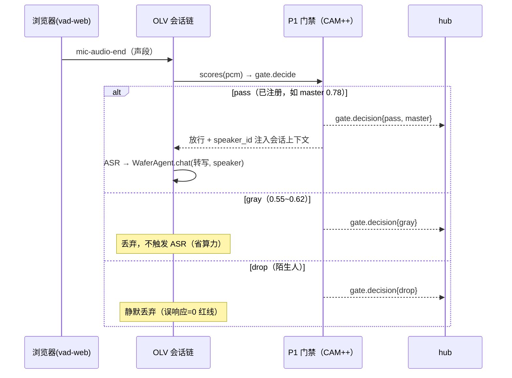
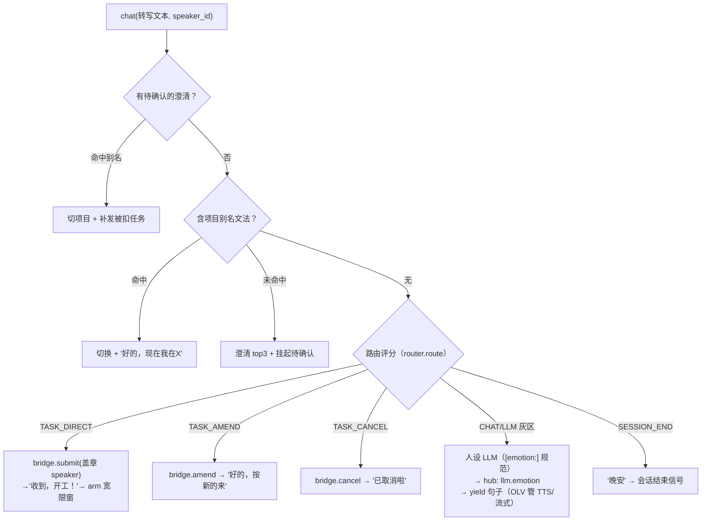
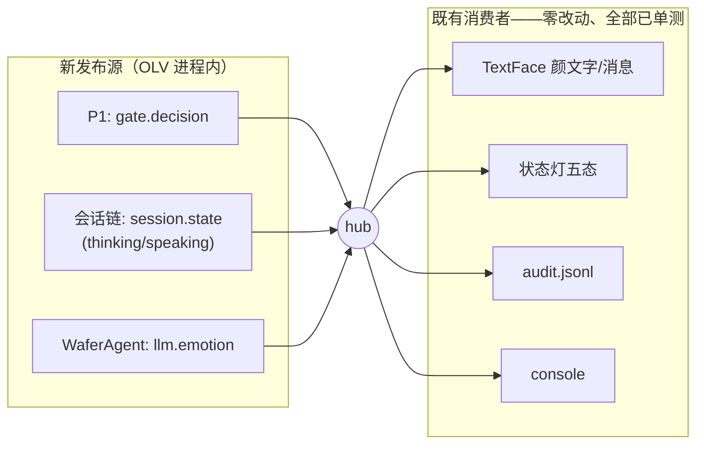
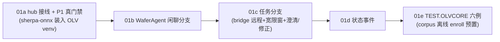
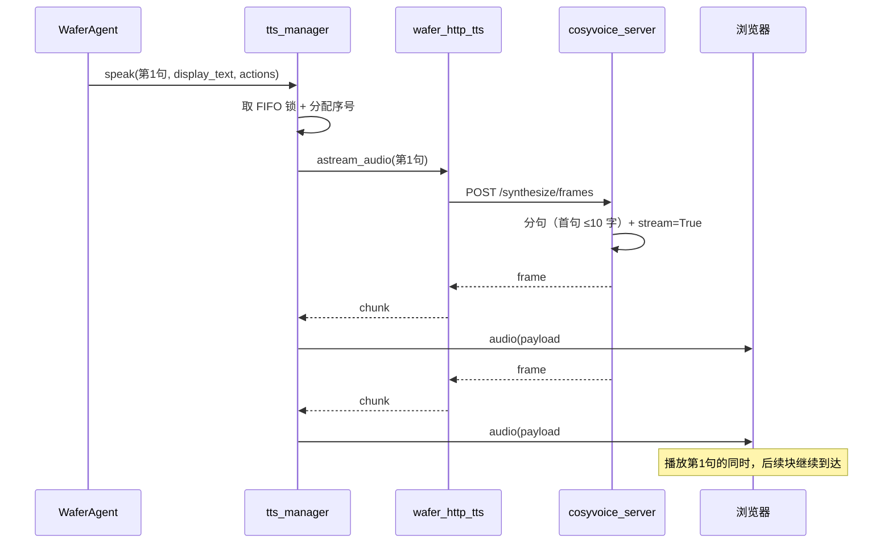
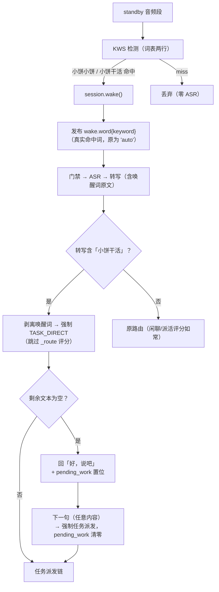
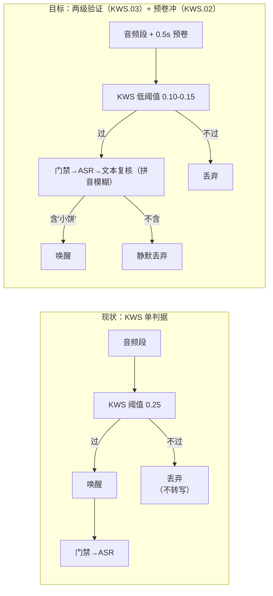
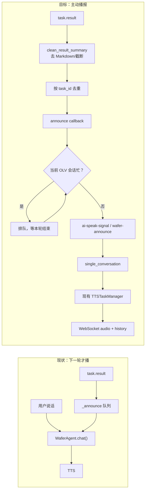

# OLV 集成设计：宿主定制层（P1-P7）与 wafer-core 接入

> 来源：设计文档 v1.7 拆分（原 §3.3 OLV 定制层 + §4.10 OLVCORE 集成，内容原样迁移）。
> 这是 TASK.OLVCORE.01 实施的工作文档。

### 3.3 olv-wafer：宿主引擎介绍与定制层

**Open-LLM-VTuber（OLV）是什么**：开源语音 AI 伴侣框架（MIT，14k★，调研阶段选定，详见《语音交互个人助手调研报告.md》）。原始形态 = 浏览器前端（麦克风采集 + Live2D 形象显示）+ Python 服务器（VAD/打断、ASR/LLM/TTS 供应商编排、对话持久化、自定义 Agent 扩展点、MCP 客户端支持）。它对本项目的价值是一套**成熟的"音频会话引擎"**——"持续在听、能被打断、边说边想"这层最难调的管道已经做完并经过社区验证。

**用它什么 / 不用什么**：

| ✅ 用 | ❌ 不用 |
|---|---|
| 服务端音频管线（VAD/打断/持久化） | Live2D 前端与角色显示（D1 已弃） |
| 供应商生态（faster-whisper / CosyVoice / Edge / Ollama / OpenAI 兼容） | 其情绪→Live2D 表情映射（自有渲染管线替代） |
| 自定义 Agent 扩展点（WaferAgent 挂载处） | 其长期记忆模块（自建档案+摘要替代） |
| MCP 客户端（bridge 挂载处）+ **浏览器音频页**（裁剪版前端：采集/播放/AEC） | 完整前端 UI（角色窗口等） |

**与 wafer-core 的关系（底盘与司机）**：olv-wafer 是底盘和发动机——音频会话引擎；wafer-core 是司机和导航——会话/门禁/路由/记忆/Agent，全部业务决策。wafer-core 以**进程内 Python 包**注入 olv-wafer，两者的边界就是 HAL：core 只 import 接口、不 import OLV 代码，接口由 olv 适配层实现。由此获得两个自由度：core 可脱离 OLV 单元测试；OLV 可整体替换（v2 重写成熟后、或将来自建管线），core 无感迁移。

维护策略：fork 固定 OLV 版本，补丁以 `olv/patches/*.patch` 序列文件管理，升级时手动 rebase（v1 冻结）。

| 补丁点 | 位置 | 作用 |
|---|---|---|
| **P1 门禁钩子** | ASR 之前 | 声段先过 `SpeakerVerifier`，未通过则丢弃（不触发 ASR）——**T0.4 已实测**（插入点 `process_single_conversation`，+20 行） |
| **P2 自定义 Agent** | OLV Agent 扩展点 | 注册 `WaferAgent`（§3.6）——**T0.5 验证**：非插件注册表而是 if/elif 工厂，需三处机械补丁（config Literal 白名单 + AgentSettings 字段 + Factory 分支）；AgentInterface ABC 契约清晰（chat/handle_interrupt） |
| ~~P3 TTS 幅度 tap~~ **已消除（T0.5）** | （无需补丁） | audio 帧自带 `volumes` 数组（归一化 RMS，20ms/块=50Hz）——适配层直接转发为 hub `tts.amplitude`，嘴动数据白捡 |
| **P4 状态上报** | 既有 control 帧 | chain-start/end、interrupt、mic-audio-end 已存在——适配层转发到 hub；仅"VAD 说话起点"需 ~3 行补丁 |
| **P5 唤醒待机态**（v1.1） | 待机只跑 WakeWordEngine | 不做 ASR（零转写）——已实施（`p5_wake_hook.exploratory.patch`，M6/T6.4） |
| ~~P6 原生音频后端~~（**未实施**） | 音频传输层 | **被动优化项，保持未实施**：浏览器路径未暴露 AEC 问题前不启动（原设计如此，R.13 后仍有效） |
| **P7 wafer 本地服务接入**（R.13，2026-10-18） | OLV 供应商层 | **⚠️ 编号澄清**：补丁文件名叫 `p6_wafer_servers.patch`（沿用了 P6 编号但语义完全不同）——实际是 P7：`wafer_llama_asr`/`wafer_http_tts` 两个供应商适配器 + factory 补丁，把 OLV 的 ASR/TTS 指向本地 llama-server :8001 与 CosyVoice :9880；配合 `scripts/setup_olv.py`（conf.yaml 生成）+ `scripts/run_olv.py`（启动器 + Edge 音频页） |

### 4.10 wafer-core 集成进 OLV（TASK.OLVCORE.01，2026-10-23 设计稿待裁决）

> **背景**：2026-10-23 覆盖地图审计发现缺口 C——wafer-core（闭环 A 已全测的业务大脑）未装进 OLV 生产壳（P1 门禁是 rms 能量桩、P2 WaferAgent 未挂载、路由/派活/情绪标签不在 OLV 链内）。本节是该集成的机制设计；测试设计见 TEST_DESIGN（随实施登记 §4.24）。
> **裁决（D42，2026-10-23 用户确认 A 方案）**：v1 = **声纹守门常听制**（陌生人误响应=0 由 CAM++ 门禁保证；D22 风险①"注册者被插嘴"残留，缓解 = 单人注册 + OLVCORE.02 尽快叠加唤醒词）。

#### 4.10.1 集成架构：只在两个决策点插入，不碰 OLV 的编排与音频流



核心思路：**听/说/打断/流式是 OLV 最成熟的部分，全部保留**；wafer-core 只接管"说话人是谁"（P1）和"这句话干什么"（P2 路由）。bridge 走 RemoteExecutor + TASK_REQUEST 跨进程（D28 机制现成，零新协议）。

#### 4.10.2 P1 真门禁时序



#### 4.10.3 P2 WaferAgent：每句话的路由决策



**与闭环 A 的关系**：此图即 `ConversationPipeline._run_turn_inner` 的中段（去掉 gate/ASR/TTS——归 OLV）。修正回路天然成立：bridge 的宽限窗/amend 状态跨轮驻留在 Bridge 实例，下一轮 `route(task_ctx=bridge.has_work())` 语义一致。**[joy] 前缀问题在此解决**：WaferAgent 全权拥有 prompt（`build_chat_system_prompt`），OLV 原生 agent 退役；闲聊 LLM 复用 OLV 注入的 LLM 实例（local llama-server / 云替身均可）。

#### 4.10.4 事件流：消费端零改动



#### 4.10.5 实施拆解与测试



TEST.OLVCORE 族（闭环 A+B 合一验收，`verify.py olvcore` 套件）：01 master 闲聊（gate pass→thinking→emotion→音频）/ 02 陌生人 drop（零 ASR 零回复，红线）/ 03 派活全链（盖章→真 opencode→ok=True）/ 04 失败注入（ok=False）/ 05 宽限窗修正 / 06 多项目澄清。用例细节随实施登记 TEST_DESIGN。

#### 4.11 TTS 分块流式（R.17 / D45，2026-10-25）

**问题**：首声 3.28s 里 TTS 首句占 2.31s —— 旧链路是"整句合成完 → 一个 wav → 一次下发"，模型本身早就支持流式，瓶颈在传输粒度。



**关键约定**
- 帧 = 完整 wav（浏览器可直接解码），帧边界由 `u32 BE` 长度给出；顺序 = 服务端分句顺序。
- `display_text`/`actions` 只在**该句第一块**携带（否则 UI 会重复追加文本）。
- 序号在**发送时**分配并持锁直到底层流结束 → 多句并发时仍严格有序（AUDIO-08）。
- 兜底：引擎未声明 `supports_streaming` 时走原"整句 wav"路径（其它 TTS 适配器零改动）。

#### 4.12 双唤醒词：闲聊「小饼小饼」/ 派活「小饼干活」（R.22 / D48，2026-10-26 开发机实施）

> 用户裁决（2026-10-25，家机）：两个唤醒词都能唤醒会话；命中「小饼干活」后该轮**强制走任务路由**（剥离唤醒词，跳过意图评分）；只说「小饼干活」不带任务 → 回"好，说吧"（`pending_work`，下句直达派活）；「小饼小饼」维持原路由；「派活/开工」前缀（D35）保留为兜底。

**机制**：唤醒词命中与转写在**同一段音频**上先后发生（standby 段 → KWS 命中 → 唤醒 → 同段过门禁 → ASR 转写含唤醒词原文）——因此**任务语义判定取自转写文本**（鲁棒：KWS 返回的字符串只是观测信号，转写才是路由输入），KWS 命中词仅用于 `wake.word` 事件的可观测性。



**实现落点**（四处，全部在既有文件内）：

| # | 位置 | 改动 |
|---|---|---|
| 1 | `scripts/make_keywords.py` | 词表两行：`小饼小饼` + `小饼干活`（重生成 `keywords.txt`，~30s） |
| 2 | `core/interfaces.py` + `engines/wakeword.py` | `WakeResult` 加 `keyword: str = ""`；`detect()` 回传 `kws.get_result()` 的命中词（现有代码已拿到但丢弃，一行之差） |
| 3 | `olv/wafer_hooks.py` `wake_check()` | 发布真实 `result.keyword`（替换硬编码 `"auto"`） |
| 4 | `olv/wafer_hooks.py` `WaferAgent.chat()` | ①转写含「小饼干活」→ 剥离 + 强制任务分支（在 pending_clarify 检查之后、项目提取之前）②剥离后为空 → yield「好，说吧」+ `self._pending_work = True` ③`pending_work` 置位时下一句强制任务分支并清零（一次性）④「小饼小饼」不在转写层剥离（LLM 已适应其残留，维持现状） |

**边界与裁决**：
- `pending_clarify` 优先于 work-wake（澄清等待中的非确认输入本就放弃澄清——work-wake 文本自然走"放弃→强制任务"路径，无需特判）；
- `pending_work` 一次性：下一句无论内容强制派活后清零；超时回 standby 时一并作废（挂在 `_SessionMode` 超时语义下）；
- **兼容**：D35「派活/开工」前缀快车道保留——work-wake 是第三条进任务路由的路（前缀/评分/唤醒词），互不排斥；
- 门禁不变：work-wake 同样要过 CAM++（陌生人说「小饼干活」= 静默红线，零 ASR）。

**测试**：开发机单测族 **TEST.WAKE.01~07**（TEST_DESIGN 登记）；真机验收 TEST.DEPLOY.07/08（家机，已登记）。

#### 4.12.1 唤醒可靠性工程（2026-10-30 立项，用户评审 BCDE）

> 背景：家机真实人声实测唤醒不灵敏（"调了半天也不行"）。根因分层诊断：**KWS 是整段一次性检测**（VAD 切段后才测，非连续流式）→ 首音节易被 VAD 起点裁掉 / 真实人声分布未标定（D31 验证用的是语料）/ AGC 关闭致电平偏低。业界对照：近场固定词本身不复杂（手机 Hey Siri 就是小检测器），复杂的是远场；我们的中场场景大概率是**工程问题**而非模型天花板。

四个方案（TASK.KWS.01~04），机制如下：



| 方案 | 机制要点 | 隐私影响 | 依赖 |
|---|---|---|---|
| **D 真实人声标定**（KWS.01） | 主人/妻子各录 10~20 次双唤醒词 + 日常对话误唤醒样本 → 离线 `kws_bench.py` 出分数分布 → FAR=0 优先定阈值（D27 式） | 无（本地录音） | 无（开发机脚本+家机录音） |
| **C VAD 预卷冲**（KWS.02） | 服务端 ws 音频层维护 0.5s 环形缓冲，VAD 触发时拼接预卷；**先看 `_dump_standby` 落盘片段证实首音节缺失再修**（证据驱动） | 无 | D（对比实验数据） |
| **B 两级验证**（KWS.03） | KWS 低阈值粗筛（放行有嫌疑的段）→ 门禁 → ASR 转写 → **文本复核**（含"小饼"的拼音模糊匹配，容忍小冰/小病）→ 真唤醒；不含则**静默丢弃**（不回应） | **⚠️ 需 D22 修订（A 级）**："待机零转写" → "低阈值触发片段进 ASR"；范围仅限 KWS 分数 ≥ 低阈值 | D（定低阈值） |
| **E 两段式交互**（KWS.04） | 裸「小饼小饼」→ **固定应答**（不经 LLM："嗯？我在呢"）；裸「小饼干活」→ 保持"好，说吧"+pending_work；HOME_GUIDE 写推荐用法 | 无 | 无 |

**执行顺序**：D（找真相）→ C（修根因，若 D 证实胃音节问题）→ B（上保险，用 D 的数据定阈值）；E 可并行（半天）。
**不在 v0.1 范围**：A 方案 PTT 回退（麦克风开关 + WAFER_ALWAYS_ON 永不休眠补丁，10 行）——待用户拍板即做，作为验收期兜底。

#### 4.13 任务结果主动播报（TASK.RELEASE.08，v0.1，2026-11-01）

**问题**：`task.result` 到达后只进入 `WaferAgent._announce`，而 `_announce` 只在下一轮 `chat()` 刷新。OLV 本身有 `ai-speak-signal` 主动播报入口，但 WaferAgent 适配器没有把 result 接到该入口；因此 UI 显示“搞定”，但用户不说话就没有 TTS。

**目标**：任务完成后，无需用户再说一句，自动用现有 TTS 播报清理后的结果摘要；普通闲聊/派活/权限路径不变。



**修改落点**：

| 文件 | 改动 |
|---|---|
| `olv/wafer_hooks.py` | `clean_result_summary()`；`_on_result()` 清理/去重后调用 `announce_cb`；`set_announce_callback()`；`WaferAgent.chat(..., metadata=None)` 识别 `wafer_announcement` 后直接 yield，不路由/不调 LLM；保留 `_announce` fallback |
| `olv/upstream/.../agent/agent_factory.py` | `_WaferAgentAdapter.chat()` 把 `BatchInput.metadata` 传给 WaferAgent；注册/转发 announce 回调 |
| `olv/upstream/.../conversations/conversation_handler.py` | 扩展 `ai-speak-signal`：允许 `announcement` 文本，生成 `BatchInput` 时带 `proactive_speak/skip_memory` metadata；不再只加载固定 `proactive_speak_prompt` |
| `olv/upstream/.../conversations/single_conversation.py` | 复用现有 TTS/history 管线；确认主动播报不重复写 human 消息 |
| `olv/upstream/.../websocket_handler.py` | 可选：新增内部 `wafer-announce` 消息类型；若扩展 `ai-speak-signal` 则只需注册当前连接的发送/触发回调 |

**行为与边界**：

- 任务完成后自动播报，不需要用户再说“结果呢？”。
- 当前轮 TTS 正在播放/对话进行中：结果先排队，等本轮结束再播，不插话。
- 同一 `task_id` 只播一次；失败/超时保留 `_announce`，下一轮仍可补播。
- 摘要先清理 Markdown/表格/代码块，限制约 80–120 字；不直接读原始长 summary。
- 普通用户输入仍走原 `chat()` 路由；主动播报不触发路由/LLM。
- 对话历史是否写入由 metadata 决定；默认写 AI 消息，方便回看；human 不新增。

**验收**：

- `TEST.SERVE.19`：任务完成、用户不说话 → 自动 TTS，摘要正确。
- `TEST.SERVE.20`：当前对话正在播报时 result 到达 → 排队、不重叠、不重复；失败后 `_announce` 可补播。

**v0.1 范围**：只做任务结果主动播报；闲聊多轮上下文归 `TASK.CORE.02`（v0.2）。

---

#### 4.14 v0.1 ASR 唤醒兜底（TASK.KWS.06，2026-11-01）

**背景**：真实声线在现款 KWS 与候选 `zh-en-3M-2025-12-20` 上均为 1/17 命中；阈值 0.05–0.25 无效。按用户 A 级裁决，v0.1 主流程优先，KWS 不阻塞。

**默认路径**（`WAFER_WAKE_MODE=asr`）：

```text
standby
  → VAD 语音段
  → CAM++ gate（先挡陌生人，避免陌生人进 ASR）
  → 本地 CPU ASR（127.0.0.1:8001）
  → 文本归一化（去空格/标点）
  → 含「小饼小饼」或「小饼干活」？
      是 → session.wake() → 原闲聊/派活路由
      否 → 静默丢弃（不调 LLM/bridge）
```

- `WAFER_WAKE_MODE=kws` 保留为实验开关；`WAFER_ALWAYS_ON=1` 仍是彻底常听。
- 会话 active 后保持 D8：后续发言无需再次说唤醒词；300s 空闲回 standby。
- ASR 只跑 VAD 段，不是持续逐帧；0.6B Q8 CPU 实测约 0.64s/句，空闲不推理。
- 隐私：ASR 本地不外发；但日志/history 仍可能保留转写文本，后续可做 no-wake 不落 history。
- 已知取舍：VAD 仍可能截断首音节；active 期间旁人/回声仍可能被 ASR 转写并路由。v0.1 接受，后续再收紧。

**实现落点**：`olv/wafer_hooks.py::_wake_mode/_has_asr_wake`；`gate_check` standby 分支；`WaferAgent.chat` standby 文本匹配；`tests/test_asr_wake.py`。

---
