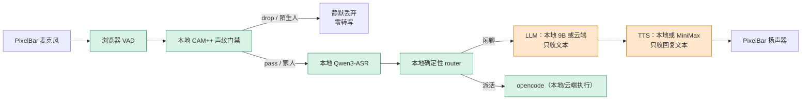

# 在线 API 供应商（v0.2）

> 状态：2026-11-05 方案定稿，TASK.PROVIDER.01-03 开发中。
> 一句话：**本地门禁与本地 ASR 是隐私边界；云端只接触“已放行的文本”和“要播报的文本”**，不接触原始音频。

## 1. 目标与非目标

| 目标 | 说明 |
|---|---|
| LLM 任意 OpenAI 兼容 API | DeepSeek v4.1 flash、火山 Ark、DeepSeek 官方、其他兼容端点；配置切换 |
| TTS 在线音色 | MiniMax T2A v2；目标音色 `Chinese_crisp_podcaster_nv1` |
| ASR 保持本地 | 本阶段不把 ASR 音频发云端；在线 ASR 仅作为后续可选扩展 |
| 密钥不入库 | 真实 key 只进 `.env`；端点/模型进 `config/providers.local.yaml`（gitignored） |
| 可降级 | 云 API 失败 → 现有规则 6：LED/通知 + 沉默，不阻塞本地会话 |

非目标（本阶段）：云端 ASR、云端唤醒词、把门禁搬到云端。

## 2. 数据边界



**硬边界**：
- `gate=pass` 之前的音频永远不出本机；`drop`/`gray` 不进入任何云端。
- 云端 LLM 收到的是本地 ASR 后的文本（以及人设/历史）；云端 TTS 收到的是助手回复文本。
- 本次不实现云端 ASR；即使未来加入，也必须复用本地 VAD + CAM++ gate，且只在 `listening/active` 状态上传，绝不在 standby 全量上传。

## 3. 配置分层（密钥与端点分离）

优先级：**环境变量 > `config/providers.local.yaml` > `config/inference.yaml` 默认值**。

```text
config/inference.yaml                 # 入库：默认本地三件套 + 供应商字段骨架（无密钥）
config/providers.local.yaml           # 不入库：用户真实端点/模型/音色（.gitignore）
.env                                  # 不入库：真实 API key（.gitignore）
config/providers.local.example.yaml   # 入库：可复制的空白模板
```

`config/providers.local.yaml` 示例：

```yaml
llm:
  provider: openai_compat
  openai_compat:
    base_url: https://api.deepseek.com/v1   # 或火山 Ark / 其他兼容端点
    model: deepseek-v4.1-flash

tts:
  provider: minimax
  minimax:
    model: speech-2.8-hd
    voice_id: Chinese_crisp_podcaster_nv1
```

`.env` 只放密钥：

```dotenv
WAFER_LLM_API_KEY=...
MINIMAX_API_KEY=...
# MiniMax 旧版/特定账号如需分组：
# MINIMAX_GROUP_ID=...
```

## 4. 供应商实现

### 4.1 LLM

- OLV 侧继续使用 `openai_compatible_llm`；`scripts/setup_olv.py` 从合并后的配置写入 `conf.yaml`（该文件 gitignored）。
- 本地模式：`llm.provider=local` → `http://127.0.0.1:8080/v1`，`llama-server` 照旧启动。
- 云端模式：`llm.provider=openai_compat` → `base_url` + `WAFER_LLM_API_KEY` + `model`；不启动本地 9B，不占显存。
- 云端兼容性：只使用 `/chat/completions` + SSE；不依赖 tool calling；`[emotion:tag]` 解析失败时回退 `normal`。
- 现有 `engines/llm_api.py` 保留为测试/离线 E2E 客户端；生产以 OLV 的 OpenAI 兼容客户端为准。

### 4.2 TTS（MiniMax T2A v2）

新增 `scripts/minimax_tts_server.py`，保持现有 TTS HTTP 契约：

- `GET /health`
- `POST /synthesize` → `audio/wav`
- `POST /synthesize/frames` → `u32 BE length + wav`

请求（非流式，WAV hex 返回）：

```json
{
  "model": "speech-2.8-hd",
  "text": "你好呀",
  "stream": false,
  "voice_setting": {
    "voice_id": "Chinese_crisp_podcaster_nv1",
    "speed": 1,
    "vol": 1,
    "pitch": 0
  },
  "audio_setting": {
    "sample_rate": 32000,
    "format": "wav",
    "channel": 1
  },
  "output_format": "hex"
}
```

- 鉴权：`Authorization: Bearer <MINIMAX_API_KEY>`；可选 `GroupId` 头由 `MINIMAX_GROUP_ID` 注入。
- 端点：默认 `https://api.minimax.cn/v1/t2a_v2`，可用 `tts.minimax.endpoint` 覆盖（国际站 `.io`/代理）。
- 错误：HTTP 非 200、`base_resp.status_code != 0`、非 hex/WAV → `RuntimeError`，由 HTTP 500 返回；不记录 key。
- 音色 ID 原样透传，不擅自改大小写/下划线：`Chinese_crisp_podcaster_nv1`。

## 5. 切换与运维

```powershell
# 1) 本地默认（不建 local.yaml）
.\.venv\Scripts\python.exe scripts\dev_stack.py start

# 2) 在线 LLM/TTS：复制模板，填端点/音色，key 进 .env
Copy-Item config\providers.local.example.yaml config\providers.local.yaml
#    编辑 local.yaml + .env 后
.\.venv\Scripts\python.exe scripts\setup_olv.py
.\.venv\Scripts\python.exe scripts\dev_stack.py start
```

- `dev_stack` 启动 OLV 前重新生成 `conf.yaml`，避免切换配置后仍用旧端点。
- 云端 LLM 不启动本地 9B；`serve_inference` 仅启动 ASR + TTS。
- 回滚：删除/改名 `config/providers.local.yaml`，重跑 `setup_olv.py`。

## 6. 验收

1. 不含任何 key 的文件入库：`git grep -n "sk-\|MINIMAX_API_KEY=.*[A-Za-z0-9]"` 为空。
2. 本地模式全量测试不依赖网络；MiniMax/DashScope 用本地 mock。
3. 真实云模式：至少一次“文本→MiniMax WAV”与“一句闲聊→云 LLM 回复+情绪标签”；记录延迟与错误。
4. 门禁回归：陌生人/standby 不产生云端请求（日志只出现本地 gate drop）。

## 7. 需要用户提供

- MiniMax：`MINIMAX_API_KEY`；确认控制台所属站点（`.cn` / `.io`）；如账号要求 `GroupId` 一并提供；确认 `Chinese_crisp_podcaster_nv1` 在所选模型（建议 `speech-2.8-hd`）下可用。
- 云端 LLM：`base_url`、模型名、API key（DeepSeek v4.1 flash 的提供方）；也可复用本机 opencode provider。
- ASR：不需要云端 key；保持本地 qwen3-asr。运行时可在控制台切 CPU/GPU（`asr` in `data/provider_state.json`）；GPU 需 CUDA 版 llama-server，测试数据见 DEVLOG 2026-11-08（0.6B Q8：CPU 中位 0.446s / GPU 0.250s）。
