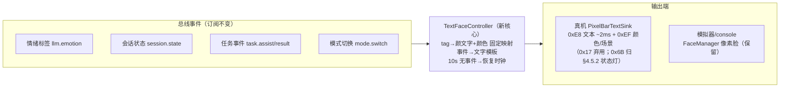
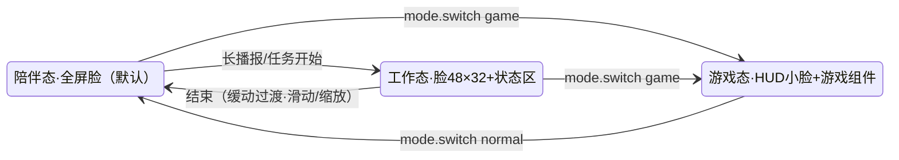
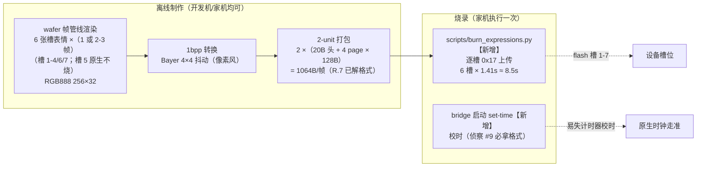

# RENDER/LED 模块设计：文本通道·状态灯·表情·console

> 来源：设计文档 v1.7 拆分（原 §4.5 渲染管线 + §4.9 console，内容原样迁移）；**2026-10-24 再次拆分：显示决策内容（画什么/何时画/状态机/词表）整体迁至 `docs/design/RENDER_POLICY.md`，本文件保留显示技术（怎么画）**。
> 职责边界：HID 线协议以 `docs/PIXELBAR_GUIDE.md` 为权威；接口契约见 `docs/SPEC.md`。

### 4.5 渲染管线（wafer-render）

#### 4.5.0 真机输出架构 v2：文本事件驱动（D36，2026-10-17 定稿）

> **模式定位（2026-10-24 审计补注）**：本节 = `expression_path: text` **文本制——现状生产模式，也是 E 方案失败时的回退模式**；E 目标态（`expression_path: slot`）见 `docs/design/RENDER_POLICY.md`。两模式词表不同：本节词表含状态文本与情绪颜文字，E 世界将其删除/降级（RENDER_POLICY §6）——**勿把本节词表当作 E 世界设计**。

> **真机实测推翻了帧通道前提**（详见 `docs/PIXELBAR_GUIDE.md` §8/§9 与 DEVLOG 2026-10-17 三节）：
> 0x17 实为 **flash 资源上传**（整帧 1.41-1.43s + 每帧弹"图片上传中"固件 UI + 社区刷新档 5/10/30 分钟），不是 RAM 帧缓冲；0xE8 文本才是唯一实时通道（20/20 ACK，中位 1.9ms）；固件文本为整屏单条字符串，**不支持叠加/分区**（"左脸右时钟"物理不可能）；ASCII 颜文字 28/28 可用，Unicode 颜文字缺字；0x6B 环境灯实测不可控（**2026-10-18 更正：真因是首字节写错，0x6B 已完全可控，见 D37/D38；氛围灯改做工作状态指示，见 §4.5.2/D39**）。

**架构**：事件驱动文本推送 + 设备原生时钟兜底。

**规则**：
- 每次推送刷新 10s 计时器；超时发 0xEF 恢复时钟（文本自动清除）；
- 说话中的情绪颜文字在 `llm.emotion` 事件时推送，说完后靠超时回时钟；
- 词表/模板/颜色为**固定映射**（铁律 2 精神：LLM 只出标签，映射不经过 LLM）；
- 颜文字仅用已验证 ASCII（Unicode 颜文字符号缺字）；文字 ≤16 字符 / ≤48 UTF-8 字节；
- 全程不切 WORK 场景（那是 0x17 的要求）、不写 flash、不碰 0x6B（氛围灯由独立的 `MoodStateController` 负责，见 §4.5.2 / D39）。

**保留不废**：原帧管线 + FaceManager 像素脸（wafer 等 11 表情）保留于**模拟器/console 预览**——开发调试与未来换设备仍有价值；铁律 3 的单一写者原则不变（TextFaceController 仍是唯一 HID 写者的上游）。

**内容词表**：已集中至 `docs/design/RENDER_POLICY.md` §6（两模式词表全集，2026-10-24 拆分）。

#### 4.5.1 帧管线（模拟器/console 预览路径，真机已不走）

> **现状（v1.5 审计）**：本小节的**版式状态机（layouts.yaml）与主题包（themes/*.yaml）未实现**——D36 杀死真机帧通道后，三版式的设计对象不存在了；模拟器路径用 RenderEventBridge 的简化 scene 概念（idle/覆盖态）。`RenderPipeline`/`SimpleFace` 是 M1 骨架（仅测试引用），主循环实际走 `FaceManager`（五风格）+ `RenderEventBridge`。`config/emotions.yaml` 未创建——情绪宏参数在 `render/faces/*.py` 各风格内实现。下文保留作为设计参考（若未来换显示设备可重启此路径）。

**表情系统底座：claw-face 移植（D24）**。经社区调研与浏览器实测（2026-10-15），选定 [morpheus-digital/claw-face](https://github.com/morpheus-digital/claw-face)（MIT）作为表情参数与动画行为的参考底座——16 种标准表情（normal/happy/sad/angry/surprised/suspicious/cute/tired/sleepy/thinking/confused/scared/upset/glee/wonder/skeptic）+ 3 种特殊态（wink/talking/typing），椭圆眼睛 + 上下眼睑 + 倾斜参数 + 不对称设计，自然眨眼（3-6s 间隔，200ms 平滑开合）、呼吸效果（眼睛尺寸微振荡）、300ms 表情间平滑过渡。**移植方式**：表情参数表 + 眨眼/过渡/呼吸逻辑移植到 Python/Pillow 渲染管线（claw-face 是 HTML/JS 渲染，我们重写渲染端但保留参数与行为设计）；LED 点阵风格（圆点+间隙）适配 256×32。19 张原版表情截图存档于 `temp_script/claw_face_captures/`。

**一句话**：render 进程每 33 毫秒跑一遍下面的主循环——画一张 256×32 的"帧"，推给输出端；机器人的脸就是这串连续的帧（节点标注：中文说明 · 术语）：

```mermaid
flowchart LR
    subgraph IN["五路信号 · 从总线订阅"]
        direction TB
        A1["情绪标签<br/>（llm.emotion · 回复时来一次）"]
        A2["说话音量<br/>（tts.amplitude · 每秒 30 个数字）"]
        A3["人声起止<br/>（audio.state · VAD 检测）"]
        A4["任务进度/结果<br/>（task.progress / result）"]
        A5["模式切换<br/>（mode.switch · 进出游戏）"]
    end

    T1["① 算表情<br/>情绪宏查表 + 实时覆盖<br/>（脸状态机）"]
    T2["② 选版式<br/>陪伴 / 工作 / HUD<br/>（版式状态机）"]
    T3["③ 画帧<br/>脸 + 文字 + 图像<br/>（合成器 · L0~L2）"]
    T4["④ 找变化<br/>只标变化区域<br/>（脏矩形 diff）"]

    subgraph OUT["输出端 · sink 可多开"]
        direction TB
        O1["真机 LED<br/>（sink-pixelbar · HID）"]
        O2["浏览器预览<br/>（sink-web · 调试主力）"]
        O3["终端像素<br/>（sink-terminal）"]
        O4["存 PNG/GIF<br/>（sink-file · 快照素材）"]
    end

    IN --> T1 --> T2 --> T3 --> T4 --> OUT
```

> 输出端的代码名叫 **sink**（Unix 管道术语：数据从源头流向"水槽"）。四个输出端可同时开——开发机只开预览+存档，家庭开真机 LED。文档其他处的 **L0-L3 编号** = ③画帧里的四类内容：L0 脸 / L1 滚动文字 / L2 图像 / L3 AI 生成（P2）。

**版式状态机**——"版式"就是**这块 256×32 屏幕的空间分法**（脸占多大、信息区在哪），"状态机"就是它是个**带记忆的开关**：记住当前在哪个版式，什么事件切到哪个，切换时带滑动/缩放过场动画。事件驱动，映射表 `config/layouts.yaml`，与游戏模式解耦（模式换主题，版式独立运转）：

**情绪宏词表 v1**（`config/emotions.yaml`，参数均为脸部绘制参数）：

> **已被取代（2026-10-24 审计补注）**：此表为 claw 时代帧管线的设计参考——现行 wafer 实现与七槽表情设计见 **RENDER_POLICY §3**（happy/sad/angry/thinking/celebrate 已全部重设计，surprised 已随 D43 退役）。保留仅作历史参考。

| 标签 | 眼形 | 瞳孔 | 嘴 | 眨眼率 | 附加 |
|---|---|---|---|---|---|
| neutral | 圆 | 居中 | 平线 | 1.0× | — |
| happy | 上弯弧 | 居中 | 上扬弧 | 0.5× | 眼角高光 |
| sad | 下弯弧 | 低垂 | 下弯 | 0.8× | 眼角泪光点 |
| angry | 锐角 | 居中 | 下压平线 | 0.3× | 眉线倾斜 |
| surprised | 大圆 | 放大 | 圆张 | 0.2× | 感叹像素 |
| thinking | 半闭 | 游移 | 平线 | 0.5× | 瞳孔转圈动画 |
| sleepy | 眯缝 | 低垂 | 微张 | 0.1× | 慢速点头 |

- 未识别标签 → neutral；标签语法 `[emotion:happy]` 由 WaferAgent 从流式首块解析并剥离；
- 帧率自适应：实测 HID 上限后从 30/15/10fps 档位选择；
- 主题（normal/game）= 调色板 + 行为集 + 信息组件包，`config/themes/*.yaml`——mode.switch 换主题，不动版式（两层解耦）。

#### 4.5.2 氛围灯：工作状态指示灯（D39，2026-10-18 定稿）

> **定位纠偏**：氛围灯**不是第二个情绪通道**（D36 已否"环境灯情绪色"），而是**小饼的工作状态指示灯**——
> 文本（0xE8）说"发生了什么"，氛围灯（0x6B）说"现在处于哪个阶段"。用户不看屏幕、只用余光即可判断
> 小饼卡在哪一步。映射是固定表（铁律 2 精神：LLM 不参与），写入由渲染侧统一发起（铁律 3：单一写者）。

**协议事实**（USBPcap 抓厂商 App 定案，详见 `docs/PIXELBAR_GUIDE.md` §5.1）：每个效果占**一个灯区**，
`light_index` 即效果选择器，`R` 承载效果码（颜色型效果的 R/G/B 是真颜色）；亮度用厂商 App 的 `0–100`，
`speed=0xFF` 表示保持；`0x72` 复位回默认色。

**语义梯度**（动态强度即紧迫度）：呼吸（静默）＜ 流光（进行中）＜ 涟漪（完成）＜ 光影（待决策）。

| 状态 | 触发事件 | 灯效（灯区） | 参数 | 驻留 |
|---|---|---|---|---|
| 待机/空闲 | 无任务（默认态） | **氛围呼吸**(1) | 固定淡蓝 `100,160,220`，speed 8 | 常驻（"心跳"） |
| 干活中 | `task.request` / `task.approve` | **流光逐影**(5) | 亮度 100、speed 保持 | 持续到下一个状态 |
| 中间结果/进度 | `task.progress` | **流光逐影**(5)（与上同档，防抖） | 同上 | 持续 |
| 需要你决策 | `task.permission` / 澄清 / 待确认 | **动态光影**(6) | 亮度 100 | **不自动回退**，直到用户回应或 60s 超时 |
| 出结果 | `task.result`（成功） | **炫彩涟漪**(4) | 亮度 100 | 5s 后回呼吸 |
| 失败/降级 | `task.cancel` / `render.command:error` / `task.result`（`ok=false` 或带 `error`） | **纯色静光**(3) **红色** | `(255,60,60)`，亮度 100 | 10s 后回呼吸（屏幕另显示降级信息） |
| 游戏模式 | `mode.switch game` | **氛围呼吸**(1)（与默认态相同） | 同上 | 保持（不做特殊档，用户裁决） |

**规则**：
- **单选切换语义**：任一时刻只有一个活跃效果，状态迁移即"写目标灯区 + 码/色"（灯区叠加性未验证，
  按单选实现——2026-10-18 用户裁决；若后续发现灯区物理独立，可升级为"底层呼吸 + 上层警示"）。
- **防抖与最短驻留**：`task.progress` 1s 内合并；任何状态最短驻留 2s（避免流式结果导致灯效抽搐）；
  只有"完成/失败"这类一次性事件走定时回退。
- **持久化与自愈**：设备会把灯效状态**跨会话保存**（抓包证实）→ 启动时校正一次到"待机呼吸"，
  进程退出时发 `0x72` 复位（或回呼吸），避免崩溃后留下"待决策"的假象。
- **亮度/夜间**：默认 100；预留配置项（夜间/游戏降档），不在此卡实现。
- **失败必须可辨**：成功与失败用不同灯区+颜色（涟漪 vs 纯色红），不靠"感觉快慢"区分。
- **不做**：情绪→灯色映射（D36 仍有效）；灯效随 LLM 自由生成；多效果叠加（除非将来验证灯区独立）。

**实现落点**（R.9 已交付）：
- `render/mood.py`：`MoodStateSpec` + `DEFAULT_STATES` + `load_mood_states()` + `MoodStateController`
  （订阅事件、最小驻留 2s、同态不写、`hold_s` 回退、待决策超时、启动校正、`stop()` 复位）；
- `config/mood.yaml`：状态→灯区/码/色/亮度/speed/hold 的唯一源（与代码默认值一致，有单测守卫）；
- `render/sinks/pixelbar/mood.py`：`PixelBarMoodSink`（只含 0x6A/0x6B/0x72，独立 HID 句柄——
  实测与文本 sink 的句柄可并存，句柄间按命令号过滤应答）；
- `render/__main__.py`：`--device` 时与 `TextFaceController` 并行启动；退出时 `stop()` → `0x72`；
- 模拟器/CI：不启动控制器（无 HID），单测用 fake sink（`tests/test_mood.py`）。

**已知缺口**：`task.result` 现在只有成功语义（opencode 执行异常不发布事件）。控制器已前向兼容
`ok=false` / `error` 字段，但要真正识别"执行失败"需给 `TASK_RESULT` 加 `ok`（bridge 侧改动，另立项）。
（2026-10-23 更新：R.15 已补全失败语义，executor 全失败路径发布 `ok=False`——缺口关闭。）

### 4.5.3 表情与文字场景总设计（已拆分）

> **本节已整体迁移至 `docs/design/RENDER_POLICY.md`**（2026-10-24 单一职责拆分：槽位分配/显示状态机/场景矩阵/词表/事件关系/参数裁决/实施卡——全部**显示决策**内容）。
> 本文件保留的**显示技术**部分：烧录流水线见 §4.5.4（原 §4.5.3.7）。

### 4.5.4 烧录流水线（原 §4.5.3.7；离线一次性，初始化仪式 ≈8.5s）

### 4.9 wafer-console：浏览器监控台（P1，决策 D13）

**定位**：运维/调试台，与 LED 预览（sink-web）合并为**同一静态页面**——开发机上是"调脸 + 看状态"工作台，家庭部署是验收与调参窗口，开源用户是零硬件体验的一部分。浏览器本就常驻，边际成本低。**可视驾驶舱（§4.6/D17）下 Edge 最小化后台常驻**——干活过程可见性由 opencode Windows 应用本身承担，控制台是偶尔回来看的调试与调参视图，不是主工作界面。

**面板内容（v1 只读，数据全部来自既有 hub 主题）**：

| 面板 | 数据源 | 用途 |
|---|---|---|
| 会话状态灯 | `session.state` / `audio.state` | 一眼看清待机/监听/思考/说话/编码 |
| 门禁流水 | `gate.decision` | 说话人 + 得分 + 判定——**阈值调校的实时观测窗**（灰区高发 = 阈值偏严） |
| 情绪与转写 | `llm.emotion` + 最近对话 | 调人设卡与标签解析 |
| 任务面板 | `task.progress / permission / result` | opencode 全过程（LED 只显示摘要，这里看细节） |
| 延迟打点 | 各阶段时间戳 | 端到端 ≤2s 指标的实时分位（§6.4） |

**v1.1 有限控制**（每项都是既有主题的新发布者，后端零改动）：任务批准/拒绝按钮（比语音批准文件操作更稳）；门禁临时关闭开关（等价热键，降低记忆负担）。

**明确不做**：参数编辑（阈值/超时仍走配置文件——§12#6 约束的是语音调节，控制台 v1 同样不做写操作，精神一致）；对话历史浏览（本地 jsonl 直接看）；任何非 localhost 暴露。

**技术形态**：单个静态 HTML + 原生 JS（无框架、无构建步骤），由 wafer-render 静态托管（与帧预览同页同端口）。**现状（v1.5）**：连接形态为 HTTP 轮询（`/api/state`+`/api/events` 1s、`/api/frame` 2fps）而非初版设计的双 WebSocket——实现更简（stdlib HTTP server），页面行为等价；新增项目面板（D33）、LED Text 卡片（D36）、表情按钮/风格选择器（F 组/M6）与帧预览。**它是 hub 的又一个订阅者，v1 后端零新增逻辑**（仅延迟打点需补一类时间戳事件，归入 bench 打点）。

**表情设计台（TASK.CONSOLE.01，2026-10-24）**：`/compare` 页——wafer 七槽词表实时预览（活渲染管线直出 + 1bpp 真机视角 + 眨眼/呼吸原生节奏；其余四风格默认隐藏可展开），是 E-4 表情改版的评审工作台；`/api/compare` 端点由 `StylePreview`（五风格独立实例，不碰主 FaceManager）供帧。

**成本与风险**：v1 只读面板约 1-2 天；安全边界 = 仅绑定 localhost（与 hub 同信任域，家庭单用户可接受）。

