# RENDER/POLICY 显示决策设计：画什么·何时画·停留多久

> 来源：RENDER_LED.md §4.5.3 全部决策内容拆分（2026-10-24）。单一职责：**RENDER_LED = 显示技术（怎么画）**，本文件 = **显示决策（画什么/何时画/停留多久/优先级）**。
> 职责边界：线协议以 `docs/PIXELBAR_GUIDE.md` 为权威；通道/管线/烧录/console 技术见 `docs/design/RENDER_LED.md`；事件契约见 `docs/SPEC.md`。
> 模式：`expression_path: slot`（E 目标态，本文件默认语境）｜ `text`（D36 文本制，现状/回退）——**v0.1 生产形态的完整显示说明见 §0**。

## 0. v0.1 文本制显示逻辑（现行生产模式，2026-10-26 补）

> 本节是 **v0.1 发布形态的真机显示全集**——`expression_path: text`（D36 文本制）。v0.1 真机只有**文字与时钟两个形态**（外加 D39 氛围灯独立并行通道，见 RENDER_LED §4.5.2）。§1 起的槽位/表情内容全部属 v0.2（E 方案）。
> 与"有嘴用嘴，没嘴用字"（§8 裁决 5，**仅 slot 模式**）的区分：v0.1 文本制中**文字是唯一视觉通道**——情绪颜文字与状态文本全部显示，语音与文字**并存**而非替代。

### 0.1 转换链路：总线事件 → 固定映射 → 0xE8 → 设备字库

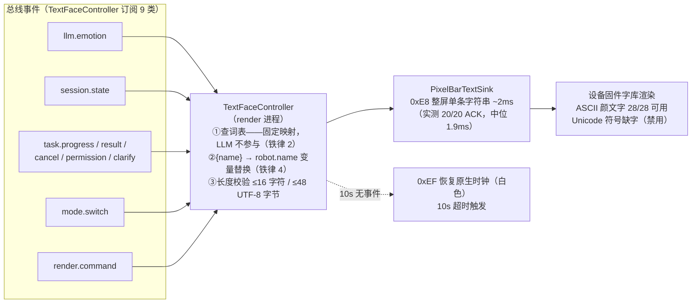

### 0.2 两形态状态机（v0.1 真机显示的全部可能）

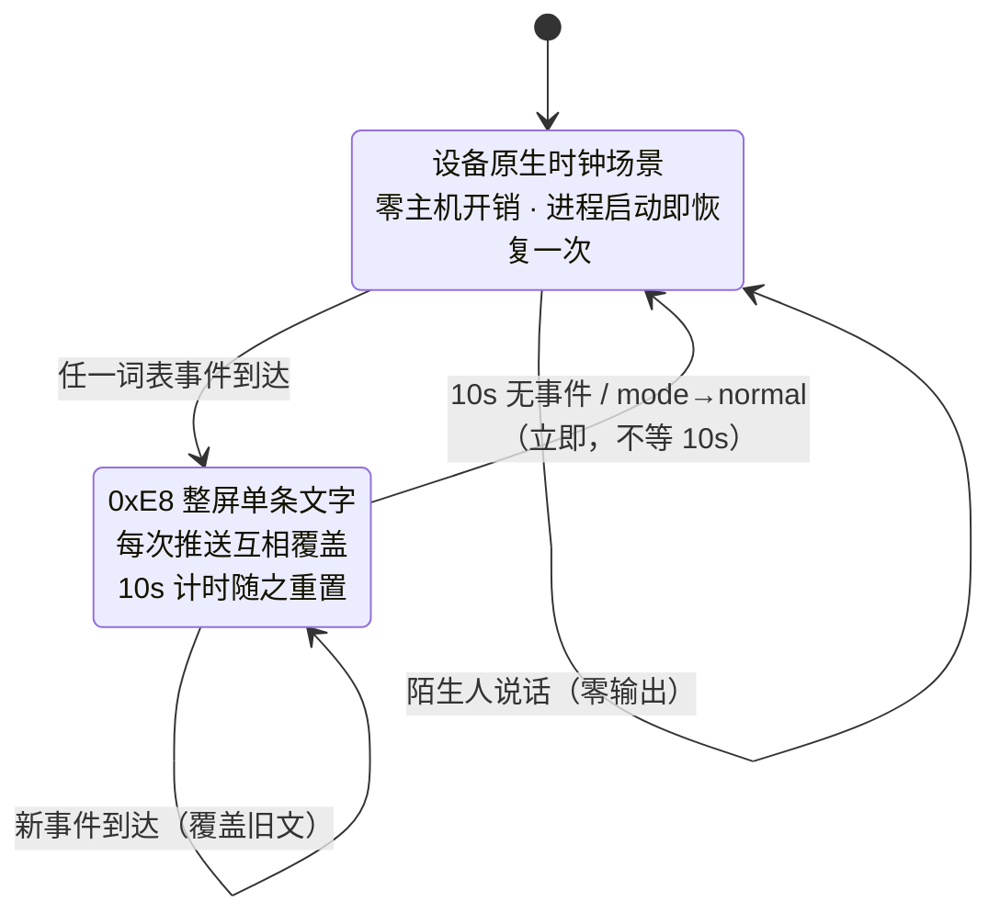

**三条行为规则**：
1. **覆盖式显示**：固件文本为整屏单条字符串，新文字直接替换旧文字——不支持叠加/分区/滚动；
2. **10s 计时随推送重置**：连续事件（如聆听→思考→情绪）会让文字态一直驻留；
3. **陌生人零输出**：TextFaceController **不订阅 gate 事件**——陌生人说话期间无任何推送，屏幕保持原状（通常已回时钟），与零 ASR、零回复共同构成静默红线。

### 0.3 词表全集（v0.1 生效的全部文字，共 14 条）

> 实现位置：`render/textface.py`（EMOTION_FACE / STATE_TEXT / EVENT_TEXT）；情绪词表与 `core.pipeline.EMOTION_TAGS` 有同步守卫测试。

| 类 | 触发事件 | 文字 | 颜色 |
|---|---|---|---|
| 情绪·平常 | `llm.emotion{tag:normal}` | `(._.)` | 浅蓝 |
| 情绪·开心 | `tag:happy` | `(^_^)` | 暖黄 |
| 情绪·难过 | `tag:sad` | `(T_T)` | 蓝 |
| 情绪·生气 | `tag:angry` | `(>_<)` | 红 |
| 状态·聆听 | `session→listening` | `{name}在听哦('o')` | 浅蓝 |
| 状态·思考 | `session→thinking` | `(?_?)` | 浅蓝 |
| 事件·派活确认 | `task.progress{phase:dispatched}` | `收到，开工！` | 浅蓝 |
| 事件·完成 | `task.result{ok:true, summary}` | `搞定！\(^o^)/` | 暖黄 |
| 事件·失败 | `task.result{ok:false 或 error}` | `呜，下次努力` | 蓝 |
| 事件·取消 | `task.cancel` | `已取消啦`（SLOT.03 专属文案） | 蓝 |
| 事件·权限确认 | `task.permission` | `等你点头哦`（SLOT.03） | 浅蓝 |
| 事件·澄清 | `task.clarify` | `没找到项目呀`（SLOT.03） | 浅蓝 |
| 事件·降级 | `render.command{cmd:error}`（铁律 6） | `{name}歇一下` | 红 |
| 事件·进游戏 | `mode→game` | `游戏愉快！` | 浅蓝 |

**边界行为**（不推送的情况）：
- 未识别情绪标签 → 回退 normal 词项；
- `task.result` **无 summary 字段 → 静默不推**；
- `task.progress` 非 dispatched 阶段 → 不推（执行期无文字，屏幕走超时回时钟）；
- 会话态 speaking / task_running / standby → 无专属文字（说话期由情绪颜文字覆盖）。

### 0.4 逐场景时序（v0.1 实际观感）

闲聊一轮：

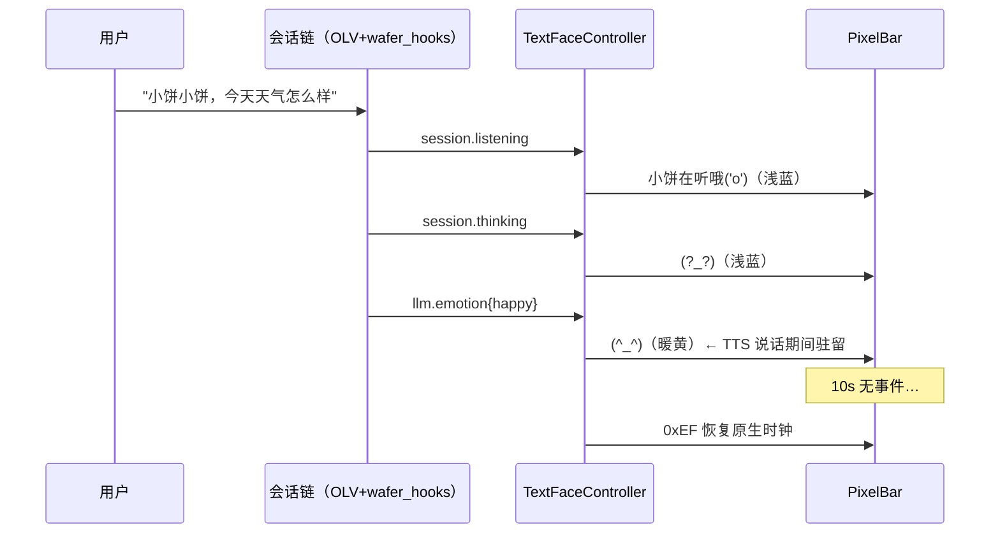

任务一轮：

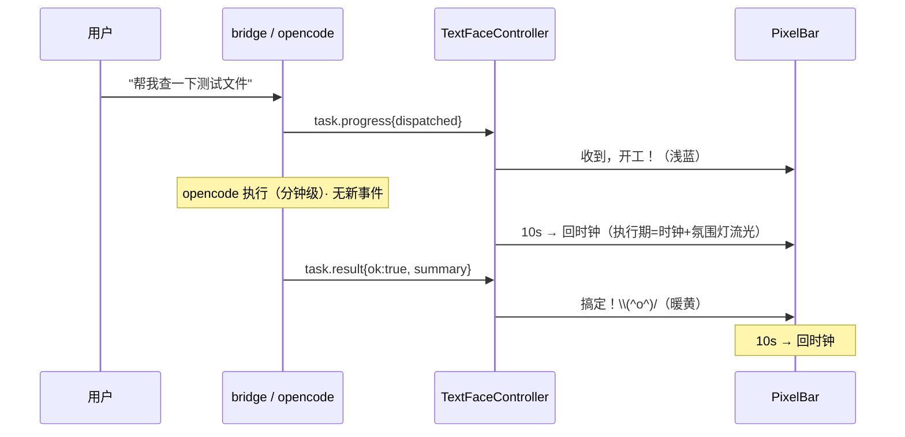

### 0.5 时钟何时显示（v0.1 唯一的"无内容"形态）

| 时机 | 途径 |
|---|---|
| 渲染进程启动 | `start()` 强制恢复一次（确保已知初始态） |
| 10s 无事件 | 超时 → `0xEF` 恢复（白色） |
| 退出游戏模式 | `mode→normal` → **立即**恢复（不等 10s） |

**三条注意**：
- 时钟是**设备原生场景、零主机开销**——render 进程挂掉时钟照走（降级友好的副作用）；
- **时钟正确性依赖校时**（TASK.SLOT.05，v0.2）：断电重启后归零，当前需连一次 TempoHub 校准——v0.1 已知缺口（DISPLAY_PATH §2.5.7-7.2）；
- 氛围灯（D39 五态）与时钟**并行不互斥**——时钟态下灯继续汇报工作状态（流光=干活中）。

## 1. 总则：两模式·四形态·优先级·三通道分工

> **设计前提（用户指令 2026-10-24）**：假设选项 E 落地——预烘焙资源可写可控、槽位间切换毫秒级（机制详见 `docs/PIXELBAR_GUIDE.md §14（机制背景）` §2.5/§2.5.7）。本节是 E 世界的**目标显示架构**，取代 v1 的"文本制为基、E 为预案"框架。
> **回退保险**：`config/render.yaml` 增加 `expression_path: slot | text` 开关——E 侦察失败或运行异常时切回 D36 文本制（v1 词表保留在代码中），零风险。
> **评审事实**：console `/compare` 五屏评审（2026-10-24）——**wafer 定为唯一发展风格**，其余四风格冻结维护。

E 落地后，真机从"只有文本"变成"表情+文本+灯"三通道，**职责重新分工**：

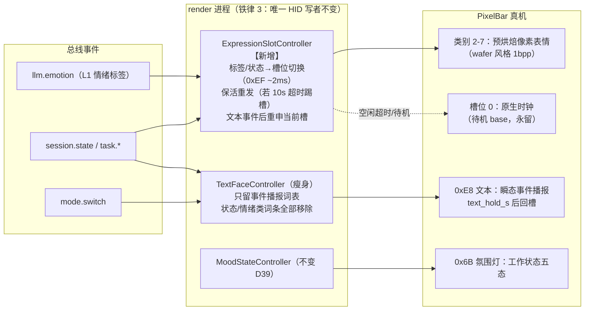

| 通道 | 回答的问题 | E 世界的角色变化 |
|---|---|---|
| **表情槽位（0xEF）** | "现在什么心情/状态" | **主显示**（v1 里是文本颜文字的活） |
| **文本（0xE8）** | "刚刚发生了什么" | 瘦身为**纯事件播报**（状态/情绪词条全部删除——槽位接管） |
| **氛围灯（0x6B）** | "进行到哪一步"（余光） | 不变（D39 五态表原样） |
| **原生时钟（场景 base）** | 待机兜底 | 永留（用户 2026-10-24 表态满意，零成本） |

**四形态与优先级（本文件总纲）**：文字（0xE8 插播）＞ 表情类别（0xEF 类别 2-7）＞ 游戏图（原生场景）＞ 时钟（类别 0 基底）——高优先级即时顶掉低优先级，文字是"插播"（**替补模式**下 5s 让位），表情是"驻留"（10s 衰减），时钟是"地板"。

## 2. 驱动分层（铁律 2 边界不变）

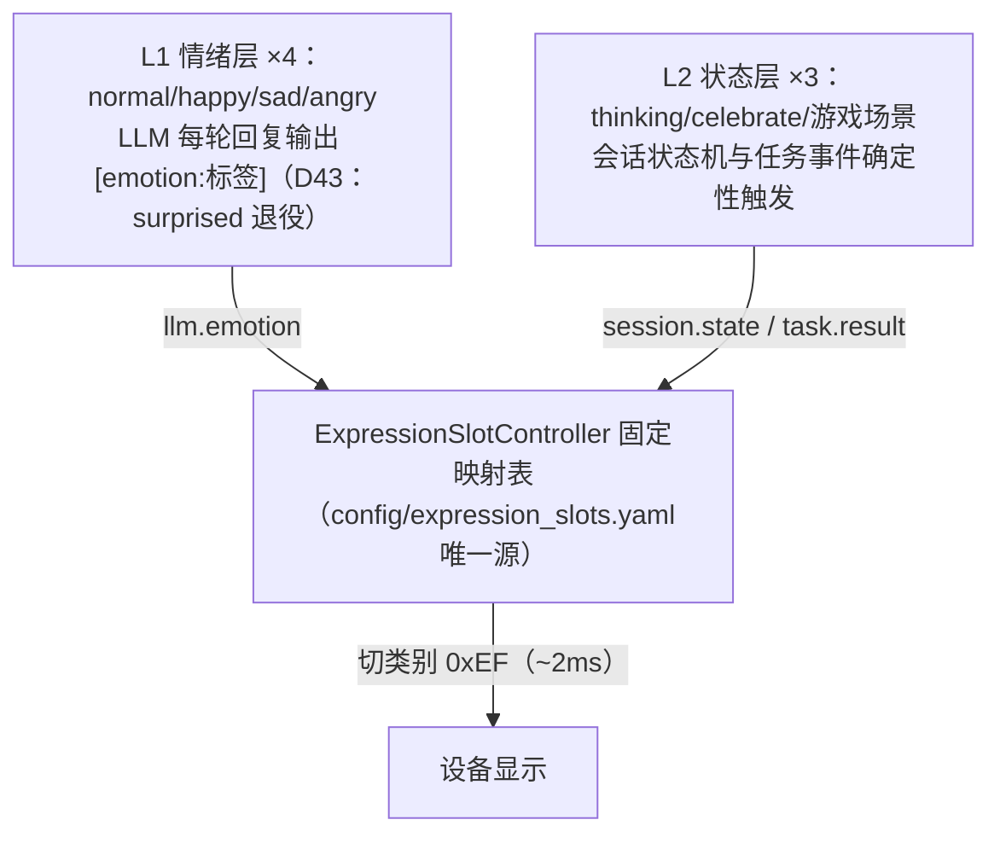

**LLM 永远只能从 L1 四标签中选**（prompt 词表 = EMOTION_TAGS，D43 后 4 个；原 5 词表的 VE2E 验证结论沿袭有效）；thinking/celebrate/游戏场景由状态机触发，LLM 不可选——铁律 2 的边界比 v1 更清晰（D43 后 L1=4，L2=thinking/celebrate/游戏场景）。

**分层的本质是"触发权"，不是"闲聊 vs 任务"的模式划分**（2026-10-24 补注）：
- 闲聊也用 L2——每轮回复都有"LLM 生成中"的思考阶段（槽 6）；任务中也用 L1——opencode 执行期间用户插话闲聊，回复照样带情绪标签；
- 表情可两层共用（normal/happy：LLM 回复选中是 L1，派活确认切到是状态触发）——分层约束的是**谁有权触发**，不是槽位独占；thinking/celebrate/游戏场景为状态机专属；
- 禁止 LLM 选 L2 的理由 = 防止模型"**演状态**"：celebrate 只能由 `task.result ok=true` 的事实触发，LLM 说了"搞定啦"不算数。

## 3. 表情类别分配（一类一表情，2026-10-26 修正）

> **架构修正（2026-10-26 用户设计确认）**：每个表情占一个独立的 PixelBar **类别**（category 2-7），而非同一类别内的不同选项。
> 原因：**类别间切换 = 0xEF 02 一条指令（~2ms）**；同类别内换选项 = 需要重新上传（不可行）。
> 本节原用"槽"（slot）术语指代此概念——修正后统一用"类别"（category）。旧"槽 N"映射为新"类别 N"（编号不变，语义修正）。

v1 把 sleepy 列为 P0——**E 世界里这是错的**：待机 = 原生时钟场景（base），sleepy 槽无事可做。7 槽重新分配：

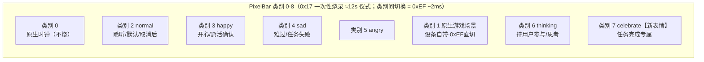

| 类别 | 表情 | 来源 | 承担场景 |
|---|---|---|---|
| 0 | 原生时钟（native category）| 设备自带 | 待机/深夜睡眠/空闲超时 |
| 2 | normal | wafer 现有 | 聆听、取消后、降级期间保持 |
| 3 | happy | wafer 重设计（弯眼 ∩∩ + grin，2026-10-24） | 开心回复、派活确认 |
| 4 | sad | wafer 重设计（3px 垂度 + 2px 厚，2026-10-24） | 难过回复、任务失败 |
| 5 | angry | wafer 重设计（＞＜紧闭眼 + 波浪抿嘴，2026-10-24） | 生气回复（L1）；**降级气鼓鼓**（state-triggered 5s，2026-10-24 裁决） |
| 1 | **原生游戏场景** | **设备自带（0xEF category 1 直切，不烧录不设计，D43 用户裁决）** | **游戏开始 10s 过渡显示后回时钟**（非常驻——D43 修订 2026-10-24）；期间遇事件按正常转换规则显示对应表情 |
| 6 | **thinking** | **wafer v2（单片眼镜·镜架固定不随眨眼 + 左移嘴；手被否——用户嫌别扭，2026-10-24）** | **待用户参与/决策 专属**（澄清、权限确认、请重复——2026-10-24 裁决：LLM 生成中与任务执行中均**不切此脸**：生成中保持 normal、执行中回时钟，"在忙"由灯流光承担） |
| 7 | **celebrate** | **wafer v1**（✧✧ 弯菱星眼 astroid 闪烁 + 最宽大笑，2026-10-24，十字星 v0 被否——用户嫌丑） | 任务完成专属——本产品的高光时刻值得独占表情 |

- **D43（2026-10-24 用户裁决）**：**surprised 从情绪词表退役**（5→4）——编码陪伴人设里价值最低的情绪（瞪圆眼震惊与"安静陪伴者"出戏），槽 5 让位原生游戏场景；游戏场景定位为**开始 10s 过渡显示后回时钟**（2026-10-24 修订：原“会话常驻脸”设计被用户简化否决——期间事件按正常转换规则）；LLM 遇惊讶场景出 normal/happy 近似，侦察发现 ≥8 槽时惊讶（重设计版）可回归第 8 槽；
- **celebrate 入选理由**：任务完成是编码陪伴产品的英雄时刻，复用 happy 与普通开心无法区分；scared/cute 由文本+灯代偿（降级有红字红光、游戏有原生场景+文案），损失最小；
- **sleepy/wink/cute/scared/tired 出局**：待机归时钟，彩蛋无槽——若侦察发现槽位 >7（未知数 #3），按 cute → scared → tired → wink 顺序递补；
- **升级路径（侦察未知数 #10，用户提案"左脸右时钟"）**：若时钟模板支持右侧布局 + 0xEF 可换背景不切场景 → 待机从"纯时钟"升级为"**左半表情 + 右半时钟**"；**执行中**亦可升级为"thinking+时钟"两全（现行设计执行中回纯时钟，2026-10-24 裁决）——槽位设计不变（表情位图只画左半即可）；
- **动画两档**（H2 帧序列成立与否）：静态 = 单帧表情；动画 = 每槽烧 2-3 帧循环（眨眼/呼吸进帧表）——**侦察第一问**。口型同步在两档下均不可用（H1b 已知损失），说话期的"活感"由眨眼循环代偿。

## 4. 显示状态机（TASK.SLOT.02 卡行为规格）

> 本节回答：四种显示形态如何切换、如何触发——是 TASK.SLOT.02 卡（ExpressionSlotController）的行为规格。

**① 基底形态状态机**（控制器视角，三个稳态 + 定时器驱动衰减）：

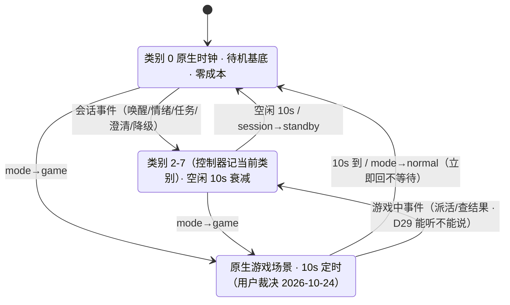

**② 显示分层决策：有嘴用嘴，没嘴用字**（2026-10-24 用户裁决——文字降级为"语音替补"）：

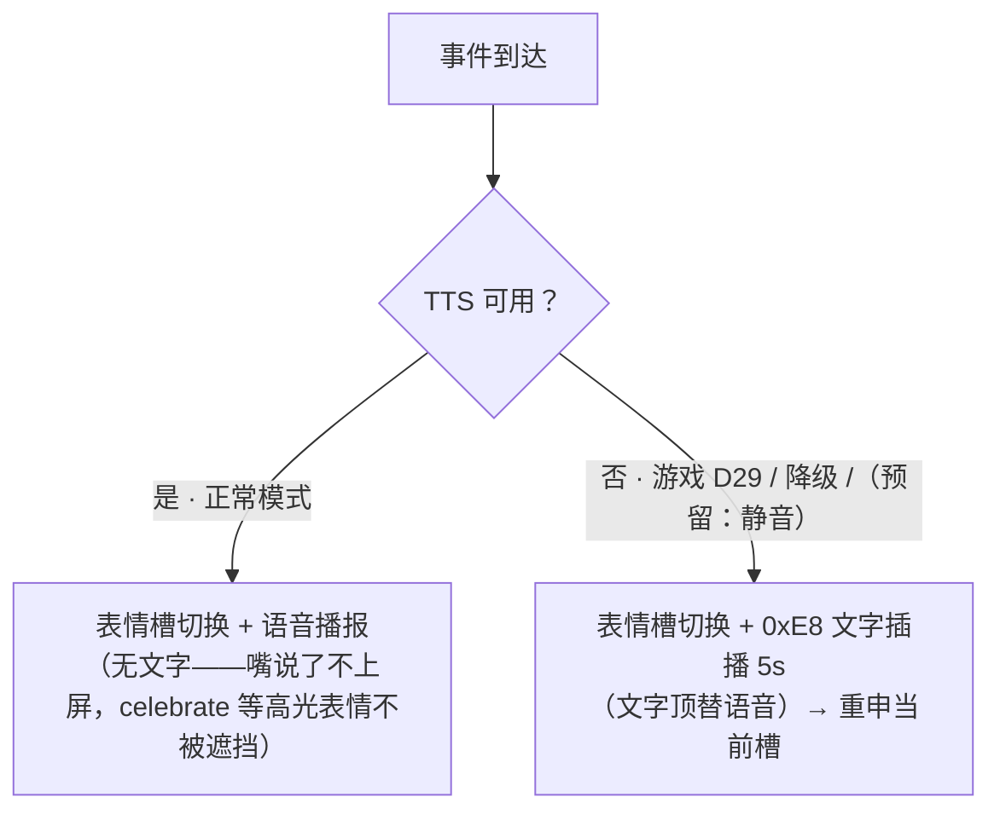

- **正常模式事件 = 表情 + 语音**（与闲聊回复同一模式——llm.emotion 期间脸随语音走，状态机无插播例外）；
- **文字词表全部保留，定位 = 语音替补**：游戏模式（D29 无 TTS，文字是唯一确认通道）、降级（语音已死）、预留静音；
- 依据事实：正常模式下事件文字几乎都有语音版本（派活/取消/澄清是 WaferAgent 语音回复，完成/失败播 summary）——文字重复语音。

**③ E 世界全场景生命周期**（2026-10-24 裁决版：生成中/执行中不切 thinking 脸；正常模式 = 表情+语音，文字仅替补）：

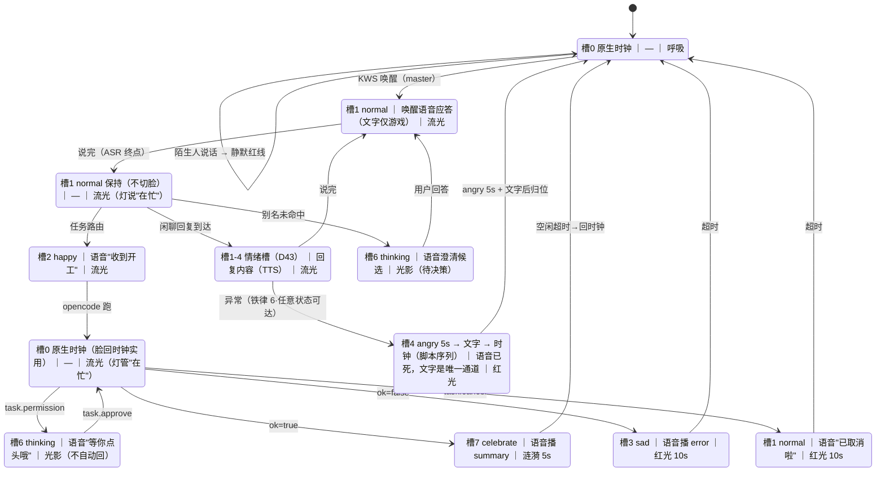

**现状（TASK.SLOT.10，2026-11-02）**：上图已由 `render/slotface.py` 落实为代码约束：
- `task.request` 记录 `task_id` → happy；`task.progress/result/permission` 只接受同 `task_id`（旧结果不覆盖新任务）。
- `task.permission` 置 `permission_pending` 并粘住槽 6；`session.listening` / `llm.emotion` 在权限、执行、结果持有期间不得覆盖。
- `task.approve`：allow=true → 槽 0（执行中），allow=false → 槽 2（normal）；`render/mood.py` 同步 decision → running/idle。
- `task.result` 槽 7/4 持有 `RESULT_HOLD_S=12s`，语音播报期间不被 listening 抹掉，超时回槽 0。

> 语音不可用模式（游戏 D29 / 降级 / 预留静音）下，图中语音词条由 **0xE8 文字顶替**（§6 替补词表，插播 5s 后重申当前槽）；游戏模式任务流**无"生成中"态**（D29 规则路由即时派活，不走 LLM）。

**④ 关键机制四条**（控制器行为）：

0. **有嘴用嘴，没嘴用字**：TTS 可用（正常模式）→ 表情 + 语音，**不发文字**；TTS 不可用（游戏 D29 / 降级 / 预留静音）→ 表情 + 文字插播；
1. **切槽即显**：状态/情绪事件 → 查 `expression_slots.yaml` → 发 0xEF（~2ms），无过渡动画（硬切换，毫秒级无顿挫感）；
2. **文字后重申（仅替补模式）**：替补文字推送 0xE8 会顶掉槽位显示 → `text_hold_s`（默认 5s）后**重发当前槽位指令**把脸请回来（文字是"插播"不是"换台"）；
3. **保活（条件启用）**：若侦察证实 10s 超时同样踢槽位场景（未知数 #5）→ 每 8s 重发一次当前槽指令（2ms/次，代价可忽略）；若槽位是 base 替换语义则关闭保活。

## 5. 场景矩阵与触发事件全表

| # | 场景 | 触发 | 槽位 | 语音（正常模式） | 0xE8 文字（替补模式） | 0x6B 灯 |
|---|---|---|---|---|---|---|
| 1 | 待机 | 空闲超时 / standby | **类别 0 原生时钟** | — | — | 呼吸 |
| 2 | 唤醒响应 | KWS 命中 | 类别 2 normal | 唤醒语音应答 | —（游戏模式无语音，走行 3 文字） | 呼吸→流光 |
| 3 | 聆听 | session→listening | 类别 2 normal | —（唤醒语音已应答，不重复） | `{name}在听哦('o')`【**仅游戏模式**】 | 流光 |
| 4 | 回复生成 | session→thinking | 类别 2 normal（**保持不切**） | — | — | 流光 |
| 5 | 说话 | llm.emotion 标签 | 类别 2-5 情绪类别 | 回复内容（TTS） | — | 流光 |
| 6 | 派活确认 | task.request | 类别 3 happy | "收到，开工！"（WaferAgent 语音回复） | 同词【替补】 | 流光 |
| 7 | 任务执行 | task.progress | **类别 0 原生时钟**（灯流光管"在忙"） | — | — | 流光 |
| 8 | 权限确认 | task.permission | 类别 6 thinking | "等你点头哦"（TTS 播报） | 同词【替补】 | 光影（不自动回） |
| 9 | 完成 | task.result ok=true | **类别 7 celebrate** | summary 全文播报 | `搞定！`+摘要截断【替补】 | 涟漪 5s |
| 10 | 失败 | task.result ok=false | 类别 4 sad | error/summary 播报 | `呜，`+error 截断【替补】 | 红光 10s |
| 11 | 澄清 | task.clarify（**新增事件**） | 类别 6 thinking | 澄清候选回复（语音） | `没找到项目呀`【替补】 | 光影（不自动回） |
| 12 | 取消 | task.cancel | 类别 2 normal | "已取消啦"（语音回复） | 同词【替补】 | 红光 10s |
| 13 | 陌生拒绝 | gate drop | **不动**（保持当前槽） | **静默红线**（零输出） | **静默红线** | 不变 |
| 14 | 降级 | 铁律 6 异常 | **类别 5 angry（5s）→ 文字 → 时钟**（脚本序列） | —（语音已死） | `{name}歇一下`（红，**唯一通道**） | 红光 10s |
| 15 | 游戏模式 | mode→game | **类别 1 原生游戏场景（10s 后回时钟）** | —（D29 无 TTS） | `游戏愉快！`；**游戏中事件全走文字**（任务流无"生成中"——规则路由） | 呼吸 |
| 16 | 深夜睡眠 | 定时/手动 sleep | 类别 0 原生时钟 | — | — | 呼吸（夜间降亮度预留） |

**触发事件全表**（事件 → 槽位 + 语音（正常）/ 文字（替补））：

| 触发事件（总线） | 来源 | 槽位动作 | 语音（正常） | 文字（替补） |
|---|---|---|---|---|
| KWS 命中+门禁过 → `session.listening` | 会话状态机 | 切 2 normal | 唤醒语音应答 | `在听哦`【仅游戏】 |
| `llm.emotion {tag}` | WaferAgent 回复（D43 四词表） | 切 2-5 对应类别 | 回复内容（TTS） | — |
| `session.thinking` | 会话状态机（LLM 生成中） | **保持类别 2 normal 不切** | — | — |
| `session.standby` | 会话状态机 | 回 0 时钟 | — | — |
| `task.progress {phase: dispatched}` | bridge 转发 opencode 派单 | 切 2 happy | "收到，开工！"（WaferAgent 语音） | 同词 |
| `task.result {ok: true, summary}` | opencode→bridge | 切 7 celebrate | summary 全文播报 | `搞定！`+摘要截断 |
| `task.result {ok: false, error}` | opencode→bridge | 切 4 sad | error/summary 播报 | `呜，`+error 截断 |
| `task.cancel` | 用户语音/热键 | 切 2 normal | "已取消啦"（语音回复） | 同词 |
| `task.clarify`（事件待补） | WaferAgent 别名未命中 | 切 6 thinking | 澄清候选回复 | `没找到项目呀` |
| `task.permission` | opencode 需批准 | 切 6 thinking | "等你点头哦"（TTS 播报） | 同词 |
| `mode→game` | 语音/console | 0xEF 原生游戏场景 | —（游戏无 TTS） | `游戏愉快！` |
| `mode→normal` | 语音/console | 回 0 时钟（立即） | — | — |
| `render.command {cmd: error}` | 铁律 6 | **脚本序列：切 4 angry → 5s → 文字 → 时钟**（不走常规重申） | —（语音已死） | `{name}歇一下`（红） |

## 6. 词表全集（text 模式 + slot 模式）

### 6.1 text 模式词表（expression_path: text，现状/回退）

**内容词表**（文本制词表：状态 ×2 + 情绪 ×4 + 事件 ×8；LLM 情绪词表 = EMOTION_TAGS，D43 后 4 个）：

| 类别 | 触发 | 内容 | 颜色 |
|---|---|---|---|
| 状态·听话 | session→listening | `小饼在听哦('o')` | 浅蓝 |
| 状态·思考 | session→thinking | `(?_?)`（text 模式专属；E 世界删除——槽 6 接管） | 浅蓝 |
| 情绪 | llm.emotion（说话中） | normal `(._.)` / happy `(^_^)` / sad `(T_T)` / angry `(>_<)`（D43：surprised `(O_O)` 退役） | 情绪色（浅蓝/暖黄/蓝/红） |
| 事件·任务确认 | task 提交 | `收到，开工！` | 浅蓝 |
| 事件·完成 | task.result 成功 | `搞定！\(^o^)/` | 暖黄 |
| 事件·失败 | task.result 失败 | `呜，下次努力` | 蓝 |
| 事件·取消 | task.cancel | `已取消啦`（专属词条已裁决，待 TASK.SLOT.03 实现——现行代码暂复用失败文案） | 蓝 |
| 事件·澄清 | 别名未命中 | `没找到项目呀`（`task.clarify` 事件待补——现状 TTS-only） | 浅蓝 |
| 事件·权限确认 | task.permission | `等你点头哦`（2026-10-24 已裁决，待 TASK.SLOT.03 实现） | 浅蓝 |
| 事件·降级 | 铁律 6 | `小饼歇一下` | 红 |
| 事件·进游戏 | mode.switch game | `游戏愉快！` | — |
| 待机 | 10s 无事件 | **设备原生时钟**（0xEF 恢复，零主机开销） | — |

### 6.2 slot 模式词表 v2（**语音替补词表**——正常模式不发，仅游戏 D29/降级/预留静音，2026-10-24 裁决）

| 词条 | 内容 | 变化 |
|---|---|---|
| task_confirm | `收到，开工！` | 保留（替补） |
| task_done | `搞定！\(^o^)/` | 保留（替补） |
| task_fail | `呜，下次努力` | 保留（替补） |
| task_cancel | `已取消啦` | **新增**（v1 已裁决：取消≠失败） |
| task_clarify | `没找到项目呀` | **新增**（需先补 `task.clarify` 总线事件） |
| task_permission | `等你点头哦` | **新增**（2026-10-24 用户裁决） |
| degrade | `{name}歇一下` | 保留（降级唯一通道） |
| game_enter | `游戏愉快！` | 保留（游戏模式主通道） |
| listening | `{name}在听哦('o')` | **仅游戏模式**（正常模式语音已应答，不重复） |
| ~~thinking `(?_?)`~~ | — | **删除**（槽 6 接管） |
| ~~情绪颜文字（D43 后 ×4）~~ | — | **删除**（类别 2-5 接管；仅 `expression_path: text` 回退模式下生效） |

**词表来源分类**（固定模板 vs opencode 反馈）：

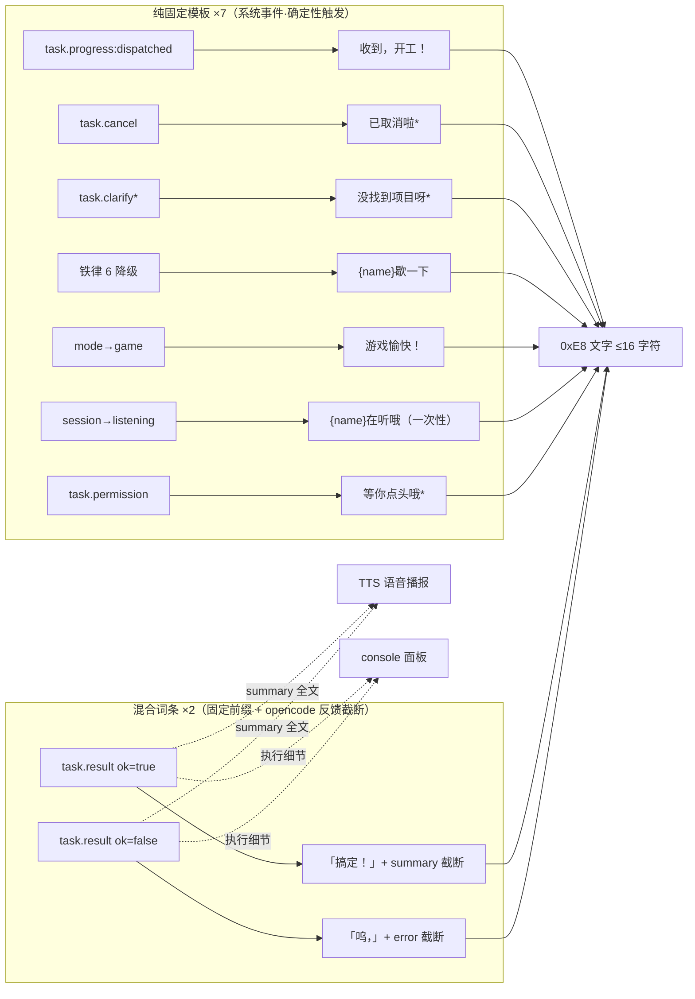

（* = 已设计待实现，归 TASK.SLOT.03 卡）

| 类别 | 词条 | 内容 | 来源 |
|---|---|---|---|
| 纯固定 ×7 | task_confirm / task_cancel / task_clarify / **task_permission** / degrade / game_enter / listening | 见上图 | 系统事件模板，**零 opencode 依赖**——opencode 挂了也照常显示 |
| 混合 ×2 | task_done / task_fail | 固定前缀 + opencode 反馈截断 | summary/error 由 bridge 从 opencode 执行结果**事实性提取**（截断不改写）；缺失时回退纯固定文案 |

**三渠道分工**（2026-10-24 修订：语音为主，文字为替补）：**语音（TTS）= 内容主通道**（正常模式事件全由嘴说）；LED 文字 = **语音替补**（游戏/降级/静音模式，16 字符级）+ `expression_path: text` 回退模式全量；console = 执行细节面板。

## 7. 与 wafer-core / opencode / bridge 的事件关系

决策层是**纯订阅者**（只消费事件，从不反向指挥 core/opencode——铁律 3 单写者 + D13 精神）；事件源全景：

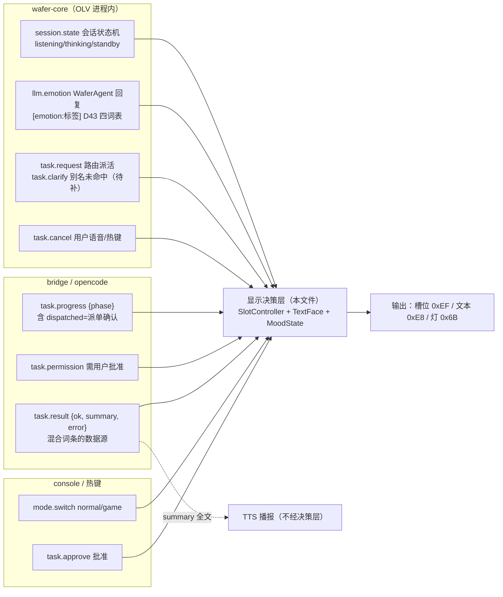

**依赖纪律**：决策层挂掉 → 事件丢失但 core/opencode 不受影响（单向依赖）；opencode 挂掉 → 纯固定词条照常显示（§6 分类），混合词条回退固定文案；gate drop（陌生拒绝）→ 决策层**零输出**（静默红线，§5 行 13）。

## 8. 设计参数与裁决记录

**设计参数**：

| 参数 | 默认值 | 说明 |
|---|---|---|
| `text_hold_s` | 5s | 替补模式文字插播时长（16 字符阅读时间），到点重申当前槽（2026-10-24：3s→5s 用户裁决） |
| `idle_timeout_s` | 10s | 空闲衰减回时钟（与设备原生 10s 对齐） |
| `game_hold_s` | 10s | 游戏场景显示时长（D43 修订） |
| keepalive | 条件启用 | 侦察 #5 若证实"10s 踢槽"→ 每 8s 重发当前槽（2ms/次）；若槽位为 base 替换语义 → 关闭 |

**裁决记录（2026-10-24 用户已裁决，原待定项清空）**：
1. `task.permission` 文案 = `等你点头哦`——随 TASK.SLOT.03 落地（D39 灯"光影"档已有，本词条补齐 LED 通道）；
2. task_done/task_fail 摘要拼接——**随 TASK.SLOT.02 一起落地**（SlotController 实现时同步升级 TextFace 混合词条）；
3. **thinking 脸专属"待用户参与"**（澄清/权限/请重复）——LLM 生成中保持 normal 不切脸、任务执行中直接回原生时钟：**灯管"在忙"（流光），脸管"心情与需要你"**；执行期回时钟反而实用（等待时可看时间），若侦察 #10（左脸右时钟）成立再升级两全；
4. **降级序列 = angry 气鼓鼓 5s → 文字"歇一下" → 回时钟**——脚本化特例（不走常规文字后重申）；angry 成为 L1 表情的 state-triggered 共用（与 happy 派活同模式）；
5. **有嘴用嘴，没嘴用字**（2026-10-24 裁决）：正常模式事件 = **表情 + 语音**（无文字——事件文字几乎都有语音版本，重复；celebrate 等高光表情不被文字遮挡）；**文字降级为语音替补**（游戏 D29 / 降级 / 预留静音，插播 5s 后重申）；"在听哦"**仅游戏模式**（正常模式唤醒语音已应答）；summary 语音后留存上屏 = **P2 可选**（暂不实现）。

**与既有规则一致性**：铁律 2（LLM 只出 L1 标签）、铁律 3（render 进程唯一写者）、D36 修订（0x17 语义收窄为"运行期禁用、初始化期烧录通道"——待 E 侦察通过后正式落 DECISIONS）、D39（灯表不变）；`EMOTION_TAGS` 4 词表（D43）与同步守卫测试继续有效。

## 9. 实施卡清单（E 侦察通过后立项）

| 卡 | 内容 | 估量 |
|---|---|---|
| TASK.SCOUT.01 | E 侦察（§2.5.4 十项未知数 + 校时格式必拿） | S（家机 1-2 会话） |
| TASK.SLOT.01 烧录 CLI | 帧管线→1bpp→2-unit 打包→0x17 逐槽烧录 + 校验回读 | M |
| TASK.SLOT.02 ExpressionSlotController | 显示状态机实现（**行为规格 = RENDER_POLICY §4**：四形态切换/触发全表 + 文字插播重申 + 条件保活）+ `expression_slots.yaml` + `expression_path` 开关 | M |
| TASK.SLOT.03 文本词表 v2 | 词条增删（含 `task_permission` 等你点头哦）+ `task.clarify` 事件（WaferAgent/bridge 侧）+ listening 降级为一次性 | S |
| TASK.SLOT.04 wafer 改版 | **五表情已重设计（2026-10-24）**：happy 弯眼+grin / sad 加深 / angry ＞＜+波浪 / thinking 单片镜 v2 / celebrate 弯菱星——console `/compare` 可预览；剩余：用户继续评审迭代 | M（进行中） |
| TASK.SLOT.05 校时 | bridge 启动 set-time（幂等） | S |
| TASK.SLOT.06 测试登记 | SLOT-* 用例族（烧录/切换/重申/保活/回退开关）进 TEST_DESIGN | S |

